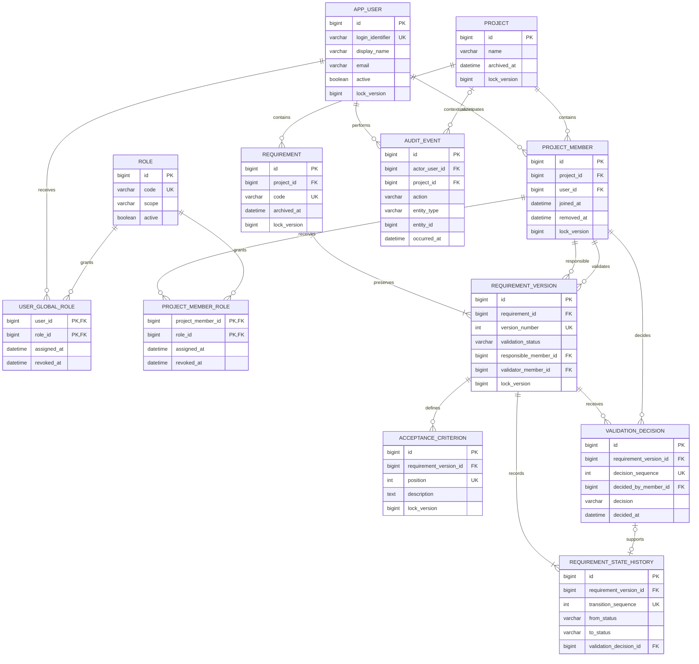

# NexoReq: Diseño del Modelo de Datos y Diccionario de Datos

> - **Identificación:** NEXOREQ-DMD-003
> - **Versión:** 0.1
> - **Estado:** Borrador para revisión
> - **Fecha:** 24 de noviembre de 2026
> - **Fuentes principales:** `docs/01-vision-y-alcance.md` y `docs/02-especificacion-requerimientos.md`, ambos en versión 0.1 y estado borrador para revisión
> - **Tecnologías de contexto:** Java 21, Spring Boot, Spring Data JPA y MySQL, bajo una arquitectura de monolito modular

## 1. Introducción

Este documento propone el modelo conceptual y lógico de datos del MVP de NexoReq, junto con un diccionario de datos orientado a MySQL. Convierte en estructuras persistentes las necesidades descritas en los Documentos 01 y 02 sin modificar su contenido, ampliar el alcance ni presentar decisiones todavía abiertas como si estuvieran aprobadas.

El modelo prioriza la integridad referencial, la normalización, la trazabilidad, la conservación histórica y el aislamiento de datos por proyecto. No representa una implementación terminada: no existen todavía entidades Java, mapeos JPA, archivos SQL, migraciones ni evidencia de pruebas asociada a este diseño.

### 1.1. Objetivos

- Identificar las entidades que soportan identidad, proyectos, requisitos, validación, versiones y auditoría.
- Definir relaciones, cardinalidades, claves, restricciones e índices propuestos.
- Conservar la identidad estable del requisito y separar su contenido versionado.
- Asociar criterios de aceptación y decisiones con la versión exacta a la que pertenecen.
- Evitar eliminaciones físicas o sobrescrituras silenciosas que destruyan trazabilidad.
- Proporcionar una base revisable para el diseño posterior de persistencia con Spring Data JPA y MySQL.
- Mantener visibles las decisiones que requieren aprobación antes de implementar.

### 1.2. Alcance del modelo

El modelo cubre los datos del MVP para:

- usuarios activos o inactivos, roles globales y roles por proyecto;
- proyectos, participantes y archivo lógico;
- identidad, contenido, clasificación y archivo lógico de requisitos;
- criterios de aceptación vinculados a versiones;
- flujo de validación, decisiones e historial de estados;
- consulta, búsqueda y filtros;
- eventos de auditoría inmutables desde la API del producto;
- control de concurrencia optimista y transacciones de los flujos críticos.

No se modelan generación de requisitos con inteligencia artificial, integraciones externas, archivos adjuntos, notificaciones, multitenencia, analítica avanzada ni un módulo funcional de gestión de pruebas, porque están excluidos del MVP. Tampoco se define una interfaz de usuario.

### 1.3. Convenciones sobre el estado de las decisiones

Para evitar confundir una propuesta técnica con una decisión aprobada, se usan estas etiquetas:

| Etiqueta | Significado |
| --- | --- |
| **Base documental** | Obligación o restricción tomada de los Documentos 01 y 02. Esos documentos continúan en estado borrador para revisión; la etiqueta no implica aprobación formal. |
| **Propuesta de diseño** | Elección técnica de este Documento 03, sujeta a revisión antes de implementar. |
| **Pendiente** | Decisión abierta identificada en el Documento 02 o asunto nuevo que necesita aprobación explícita. |

Los nombres físicos de tablas y columnas, los tipos, las longitudes, los índices y las restricciones de este documento son **propuestas de diseño**. Las reglas RN-001 a RN-007 y los requisitos trazados son la **base documental** que esas propuestas intentan satisfacer.

### 1.4. Principios de diseño

- Cada requisito tiene una sola raíz de identidad y pertenece a un único proyecto.
- El código se almacena en la raíz del requisito, no en cada versión.
- El contenido que puede versionarse se almacena en `requirement_versions`.
- Los criterios, decisiones e historial apuntan a la versión evaluada.
- El estado de validación y la condición de archivo se mantienen separados.
- Las relaciones históricas usan claves foráneas con `RESTRICT` o `NO ACTION`; no se propone borrado en cascada.
- La autorización se comprueba en el servidor y se restringe al proyecto correspondiente; una clave foránea no sustituye esa autorización.
- Las filas mutables de los agregados principales incluyen una versión de bloqueo para detectar concurrencia.
- La auditoría es append-only desde la API y no sustituye a las tablas normalizadas del dominio.
- Los módulos son propietarios de sus tablas. Una referencia entre módulos es un contrato de integridad; no autoriza a un módulo a acceder directamente mediante JPA a las tablas internas de otro.

## 2. Entidades del dominio y responsabilidades

| Entidad lógica | Tabla propuesta | Módulo propietario | Responsabilidad |
| --- | --- | --- | --- |
| Usuario | `app_users` | Identidad y acceso | Mantener identidad interna, datos básicos, estado activo y autoría histórica. No contiene todavía credenciales. |
| Rol | `roles` | Identidad y acceso | Representar un rol de ámbito global o de proyecto. El catálogo y su gobierno siguen pendientes en DP-001. |
| Asignación global | `user_global_roles` | Identidad y acceso | Asociar usuarios con roles globales y conservar asignación o revocación. |
| Proyecto | `projects` | Proyectos | Contener participantes y requisitos, y registrar su condición activa o archivada. |
| Participación | `project_members` | Proyectos | Asociar un usuario a un proyecto sin mezclar sus roles de otros proyectos. |
| Rol de participante | `project_member_roles` | Proyectos | Asignar uno o más roles de proyecto a una participación concreta. |
| Requisito | `requirements` | Requisitos | Mantener proyecto, código estable, creación y condición de archivo del requisito. |
| Versión de requisito | `requirement_versions` | Requisitos | Mantener contenido, clasificación, responsable, validador y estado de validación de una versión. |
| Criterio de aceptación | `acceptance_criteria` | Requisitos | Mantener los criterios ordenados que pertenecen a una versión específica. |
| Decisión de validación | `validation_decisions` | Validación | Conservar una aprobación o rechazo, su autor, fecha, hora, observación y versión evaluada. |
| Historial de estado | `requirement_state_history` | Validación | Conservar cada transición de una versión, incluida su creación en borrador. |
| Evento de auditoría | `audit_events` | Trazabilidad y consulta | Registrar acciones relevantes de forma append-only y consultable. |

No se propone una tabla de credenciales mientras DP-003 siga abierta, una tabla de secuencias de códigos antes de resolver DP-002, tablas de catálogos de tipo y prioridad antes de resolver DP-004, ni tablas de permisos detallados antes de cerrar DP-001. Incorporarlas ahora convertiría alternativas pendientes en decisiones aparentes.

## 3. Modelo entidad-relación conceptual

### 3.1. Conceptos y agregados

El modelo conceptual se organiza en cinco agregados o áreas de propiedad:

1. **Identidad y acceso.** Un usuario conserva una identidad estable aunque sea desactivado. Puede recibir roles globales y participar en varios proyectos.
2. **Proyectos.** Un proyecto reúne participaciones. La relación usuario–proyecto es explícita para permitir roles distintos en proyectos distintos.
3. **Requisitos.** Un requisito es la raíz estable que conserva proyecto, código y archivo lógico. Posee una o más versiones ordenadas.
4. **Validación.** Una versión recibe transiciones y, cuando corresponde, decisiones de aprobación o rechazo. El actor de una decisión es una participación del mismo proyecto.
5. **Trazabilidad.** Los eventos de auditoría registran quién hizo qué, cuándo, sobre qué entidad, en qué proyecto y con qué resultado.

### 3.2. Relaciones conceptuales

- Un usuario puede participar en cero o muchos proyectos; un proyecto puede tener cero o muchos participantes.
- Una participación puede tener cero o muchos roles de proyecto; un rol puede estar asignado a muchas participaciones.
- Un proyecto contiene cero o muchos requisitos; cada requisito pertenece exactamente a un proyecto.
- Un requisito conserva una o muchas versiones; cada versión pertenece exactamente a un requisito.
- Una versión puede tener cero o muchos criterios mientras es borrador, pero necesita al menos uno para enviarse a revisión por RN-003.
- Una versión puede recibir cero o muchas decisiones a lo largo de ciclos de rechazo, corrección y nuevo envío.
- Cada decisión pertenece a una versión y a un participante validador.
- Una versión conserva uno o muchos registros de estado, comenzando por su creación en `Borrador`.
- Un usuario genera cero o muchos eventos de auditoría y cada evento del MVP conserva un actor.
- Un evento puede tener un proyecto relacionado; es opcional solo para acciones globales, como la administración de usuarios.

### 3.3. Reglas conceptuales que no caben en una clave foránea simple

Las siguientes invariantes deben validarse por el dominio dentro de la transacción, además de las restricciones disponibles en MySQL:

- el responsable y el validador de una versión deben pertenecer al mismo proyecto del requisito;
- el validador que decide debe tener un rol vigente que lo autorice;
- un rol asignado mediante `project_member_roles` debe tener ámbito de proyecto;
- un rol asignado mediante `user_global_roles` debe tener ámbito global;
- un requisito o proyecto archivado bloquea cambios sin alterar el estado de validación;
- una versión aprobada que sea histórica no puede editarse;
- el rechazo exige una observación no vacía;
- la transición registrada debe corresponder al estado actual bloqueado de la versión;
- la autoaprobación no se permite ni se prohíbe en este diseño mientras DP-005 siga pendiente;
- el proyecto y el código de un requisito no se pueden modificar;
- la acción auditable y su evento se confirman o revierten en la misma transacción.

## 4. Modelo relacional lógico normalizado

### 4.1. Relaciones propuestas

| Relación | Clave primaria | Claves candidatas o únicas | Dependencias principales |
| --- | --- | --- | --- |
| `app_users` | `id` | `login_identifier` | Los datos básicos y el estado dependen de `id`. |
| `roles` | `id` | `code` | Nombre, ámbito y estado dependen del rol. |
| `user_global_roles` | (`user_id`, `role_id`) | Clave primaria compuesta | La asignación depende del par usuario–rol. |
| `projects` | `id` | — | Nombre, descripción y archivo dependen del proyecto. |
| `project_members` | `id` | (`project_id`, `user_id`) | La participación depende del usuario dentro del proyecto. |
| `project_member_roles` | (`project_member_id`, `role_id`) | Clave primaria compuesta | La asignación depende del par participación–rol. |
| `requirements` | `id` | (`project_id`, `code`) | Código y archivo dependen de la identidad del requisito. |
| `requirement_versions` | `id` | (`requirement_id`, `version_number`) | Todo el contenido depende de una versión del requisito. |
| `acceptance_criteria` | `id` | (`requirement_version_id`, `position`) | Texto y orden dependen de la versión. |
| `validation_decisions` | `id` | (`requirement_version_id`, `decision_sequence`) | Resultado y evidencia dependen de una decisión de la versión. |
| `requirement_state_history` | `id` | (`requirement_version_id`, `transition_sequence`); `validation_decision_id` cuando no sea nulo | La transición depende de una versión y de su posición histórica. |
| `audit_events` | `id` | `correlation_id` no es necesariamente único | Los datos del evento dependen de su identidad. |

La versión vigente se propone como la fila con el mayor `version_number` para cada requisito. La restricción única y una transacción que serializa la creación del siguiente número impiden dos versiones con el mismo orden. Esta alternativa evita el puntero circular `requirements.current_version_id` y evita mutar una versión aprobada solo para marcarla como no vigente. Materializar un puntero o indicador de vigencia queda como alternativa sujeta a evidencia de DP-007.

### 4.2. Justificación de normalización

**Primera forma normal (1FN).**

- Las columnas representan valores atómicos para el dominio.
- Los criterios de aceptación se separan porque son repetibles y ordenables; no se guardan como una lista JSON.
- Los roles se separan de usuarios y participaciones para evitar listas delimitadas.
- Las decisiones y las transiciones se almacenan como hechos individuales.

**Segunda forma normal (2FN).**

- En `user_global_roles` y `project_member_roles`, los datos de asignación dependen de la clave compuesta completa.
- Ningún atributo de una tabla de asociación depende solo del usuario, rol o participante por separado.

**Tercera forma normal (3FN).**

- Los datos del usuario, proyecto y rol no se repiten en requisitos o decisiones; se referencian mediante claves.
- La identidad estable del requisito se separa del contenido versionado.
- Los criterios, decisiones y transiciones dependen de la versión a la que ocurrieron.
- El estado actual se conserva en la versión para operar eficientemente, mientras el historial conserva hechos de transición; el historial no reemplaza ni duplica el contenido del requisito.

`audit_events.event_data` es una excepción deliberada: un JSON opcional puede conservar contexto no sensible del evento. No es fuente de verdad de contenido, estado, permisos o decisiones, y los campos necesarios para filtrar permanecen normalizados.

### 4.3. Propiedad modular y referencias

El uso de una única base MySQL permite claves foráneas entre módulos para proteger integridad. Sin embargo:

- cada tabla tiene un módulo propietario;
- un módulo consumidor almacena identificadores escalares para referencias externas;
- la aplicación valida las referencias mediante contratos del módulo propietario;
- no se propone que una entidad JPA navegue y modifique libremente agregados de otro módulo;
- los informes o consultas combinadas deben exponerse mediante contratos de consulta definidos, no mediante acceso arbitrario a repositorios ajenos.

Este criterio preserva RNF-014 sin renunciar a la integridad referencial de RNF-006.

## 5. Diagrama entidad-relación

El siguiente diagrama Mermaid usa sintaxis `erDiagram` compatible con GitHub. Muestra las relaciones de negocio principales. Las múltiples referencias de autoría hacia `APP_USER` se detallan en el diccionario y se omiten parcialmente del gráfico para mantenerlo legible.

## 6. Diccionario de datos

### 6.1. Criterios técnicos comunes

| Criterio | Propuesta |
| --- | --- |
| Motor y codificación | MySQL con InnoDB y `utf8mb4`. La versión concreta del servidor queda en DMD-P-006 y debe coordinarse con el entorno de DP-009. |
| Identificadores | `BIGINT` con identidad generada para claves simples. Se usa tipo con signo para una correspondencia directa con `Long` de Java. La estrategia exacta de generación se definirá en migraciones. |
| Fechas y horas | `DATETIME(6)` almacenado en UTC. La sesión de base de datos debe operar en UTC y la API debe exponer una representación inequívoca con zona, conforme a RNF-021. |
| Booleanos | `BOOLEAN`, que MySQL representa como `TINYINT(1)`. |
| Bloqueo optimista | `lock_version BIGINT NOT NULL DEFAULT 0` en agregados mutables. Su uso se propone para el futuro mapeo `@Version`, sin generar código en esta etapa. |
| Eliminación | Claves foráneas con `ON DELETE RESTRICT` o `NO ACTION` y `ON UPDATE RESTRICT`. No se propone `CASCADE DELETE`. |
| Nulabilidad | `NO` significa `NOT NULL`; `Sí` significa que `NULL` tiene un significado explícito. |
| Comprobaciones | Las restricciones `CHECK` son propuestas. Deben confirmarse contra la versión de MySQL que se seleccione en DMD-P-006 y repetirse en las reglas del dominio. |
| Collation del código | Pendiente en DP-002. No se fija aquí si la comparación del código distingue mayúsculas. |

Los valores de `DEFAULT` indicados son de diseño, no SQL implementado. Los nombres de restricciones se definirán en las migraciones futuras.

### 6.2. Tabla `app_users`

**Responsabilidad:** identidad básica y estado del usuario. No almacena contraseña, token ni secreto porque la estrategia de autenticación y recuperación sigue pendiente en DP-003.

| Columna | Tipo MySQL propuesto | Clave | Nulo | Restricciones propuestas | Descripción |
| --- | --- | --- | --- | --- | --- |
| `id` | `BIGINT` | PK | No | Identidad generada | Identificador interno estable. |
| `login_identifier` | `VARCHAR(191)` | UK | No | Único; no vacío | Identificador de acceso provisional. Su semántica final depende de DP-003. |
| `display_name` | `VARCHAR(150)` | — | No | No vacío | Nombre mostrado del usuario. |
| `email` | `VARCHAR(254)` | — | Sí | Formato válido cuando exista; su eventual unicidad queda por revisar | Correo básico opcional; no define por sí solo autenticación ni recuperación. |
| `active` | `BOOLEAN` | — | No | `DEFAULT TRUE` | Indica si puede obtener nuevos accesos. La desactivación no borra autoría. |
| `created_at` | `DATETIME(6)` | — | No | UTC | Fecha y hora de alta. |
| `created_by_user_id` | `BIGINT` | FK | Sí | FK a `app_users.id`, `RESTRICT` | Administrador que registró la cuenta. Puede ser nulo únicamente para la inicialización controlada del sistema; el mecanismo queda por definir. |
| `updated_at` | `DATETIME(6)` | — | No | UTC; no anterior a `created_at` | Última modificación de datos básicos o estado. |
| `updated_by_user_id` | `BIGINT` | FK | Sí | FK a `app_users.id`, `RESTRICT` | Último actor de modificación; admite nulo únicamente durante la inicialización controlada. |
| `lock_version` | `BIGINT` | — | No | `DEFAULT 0`; mayor o igual que cero | Control de concurrencia optimista. |

**Observación pendiente:** no se define la cuenta inicial, el proveedor de identidad, el almacenamiento de credenciales ni la recuperación de acceso. Todo ello pertenece a DP-003.

### 6.3. Tabla `roles`

**Responsabilidad:** catálogo técnico de roles. Los códigos concretos, permisos y autoridad de asignación no se aprueban en este documento.

| Columna | Tipo MySQL propuesto | Clave | Nulo | Restricciones propuestas | Descripción |
| --- | --- | --- | --- | --- | --- |
| `id` | `BIGINT` | PK | No | Identidad generada | Identificador del rol. |
| `code` | `VARCHAR(50)` | UK | No | Único; no vacío | Código técnico estable del rol. Sus valores finales dependen de DP-001. |
| `name` | `VARCHAR(100)` | — | No | No vacío | Nombre legible. |
| `scope` | `VARCHAR(20)` | — | No | `CHECK (scope IN ('GLOBAL','PROJECT'))` | Ámbito propuesto para impedir asignaciones en la tabla incorrecta. |
| `description` | `VARCHAR(500)` | — | Sí | — | Explicación del propósito del rol. |
| `active` | `BOOLEAN` | — | No | `DEFAULT TRUE` | Permite retirar un rol del uso futuro sin destruir asignaciones históricas. |
| `created_at` | `DATETIME(6)` | — | No | UTC | Creación del rol. |

La tabla no implica una matriz de permisos aprobada. La correspondencia rol–operación y los controles contra autoasignación de privilegios superiores siguen en DP-001.

### 6.4. Tabla `user_global_roles`

**Responsabilidad:** asignar roles de ámbito global a usuarios, conservando la atribución de asignación y revocación.

| Columna | Tipo MySQL propuesto | Clave | Nulo | Restricciones propuestas | Descripción |
| --- | --- | --- | --- | --- | --- |
| `user_id` | `BIGINT` | PK, FK | No | FK a `app_users.id`, `RESTRICT` | Usuario que recibe el rol. |
| `role_id` | `BIGINT` | PK, FK | No | FK a `roles.id`, `RESTRICT` | Rol global asignado. |
| `assigned_by_user_id` | `BIGINT` | FK | No | FK a `app_users.id`, `RESTRICT` | Actor que realizó la asignación. Su autorización depende de DP-001. |
| `assigned_at` | `DATETIME(6)` | — | No | UTC | Momento de la asignación vigente o más reciente. |
| `revoked_by_user_id` | `BIGINT` | FK | Sí | FK a `app_users.id`, `RESTRICT` | Actor que revocó el rol. |
| `revoked_at` | `DATETIME(6)` | — | Sí | UTC; no anterior a `assigned_at` | Momento de revocación. `NULL` significa asignación vigente. |

Se propone una restricción para que `revoked_by_user_id` y `revoked_at` sean ambos nulos o ambos no nulos. La clave compuesta admite una sola fila por usuario y rol; una reasignación futura reactivaría esa relación y su secuencia histórica completa quedaría en `audit_events`. Si el negocio exige períodos consultables como filas independientes, deberá reemplazarse por una clave sustituta y una unicidad de asignación activa. Esta decisión forma parte del refinamiento de DP-001.

### 6.5. Tabla `projects`

**Responsabilidad:** raíz del proyecto y su condición de archivo.

| Columna | Tipo MySQL propuesto | Clave | Nulo | Restricciones propuestas | Descripción |
| --- | --- | --- | --- | --- | --- |
| `id` | `BIGINT` | PK | No | Identidad generada | Identificador del proyecto. |
| `name` | `VARCHAR(150)` | — | No | No vacío | Nombre identificable del proyecto. No se declara único porque el Documento 02 no lo exige. |
| `description` | `TEXT` | — | Sí | — | Descripción opcional. |
| `created_by_user_id` | `BIGINT` | FK | No | FK a `app_users.id`, `RESTRICT` | Usuario que creó el proyecto. |
| `created_at` | `DATETIME(6)` | — | No | UTC | Momento de creación. |
| `updated_by_user_id` | `BIGINT` | FK | No | FK a `app_users.id`, `RESTRICT` | Usuario que realizó la última actualización. |
| `updated_at` | `DATETIME(6)` | — | No | UTC; no anterior a `created_at` | Última actualización. |
| `archived_by_user_id` | `BIGINT` | FK | Sí | FK a `app_users.id`, `RESTRICT` | Usuario que archivó el proyecto. |
| `archived_at` | `DATETIME(6)` | — | Sí | UTC | `NULL` indica proyecto activo. Archivar no modifica requisitos hijos. |
| `lock_version` | `BIGINT` | — | No | `DEFAULT 0`; mayor o igual que cero | Control de concurrencia optimista. |

Se propone que `archived_by_user_id` y `archived_at` sean ambos nulos o ambos no nulos. La eventual reactivación no se define mientras DP-011 permanezca abierta.

### 6.6. Tabla `project_members`

**Responsabilidad:** representar la pertenencia de un usuario a un proyecto y preservar la referencia histórica incluso después de retirarlo.

| Columna | Tipo MySQL propuesto | Clave | Nulo | Restricciones propuestas | Descripción |
| --- | --- | --- | --- | --- | --- |
| `id` | `BIGINT` | PK | No | Identidad generada | Identificador de la participación. |
| `project_id` | `BIGINT` | FK, UK | No | FK a `projects.id`, `RESTRICT`; parte de UK | Proyecto al que pertenece. |
| `user_id` | `BIGINT` | FK, UK | No | FK a `app_users.id`, `RESTRICT`; parte de UK | Usuario participante. |
| `joined_by_user_id` | `BIGINT` | FK | No | FK a `app_users.id`, `RESTRICT` | Actor que asoció al participante. |
| `joined_at` | `DATETIME(6)` | — | No | UTC | Momento de la asociación vigente o más reciente. |
| `removed_by_user_id` | `BIGINT` | FK | Sí | FK a `app_users.id`, `RESTRICT` | Actor que retiró al participante. |
| `removed_at` | `DATETIME(6)` | — | Sí | UTC; no anterior a `joined_at` | `NULL` significa participación vigente. |
| `lock_version` | `BIGINT` | — | No | `DEFAULT 0`; mayor o igual que cero | Control de concurrencia optimista de la membresía. |

La restricción única (`project_id`, `user_id`) evita duplicar la pertenencia. `removed_by_user_id` y `removed_at` deben ser ambos nulos o ambos no nulos. Si se permite retirar y volver a asociar varias veces, el modelo propuesto reutiliza la misma participación y conserva cada acción en auditoría; una alternativa de períodos independientes requiere aprobación al resolver DP-001.

### 6.7. Tabla `project_member_roles`

**Responsabilidad:** permitir varios roles por participante y roles distintos entre proyectos.

| Columna | Tipo MySQL propuesto | Clave | Nulo | Restricciones propuestas | Descripción |
| --- | --- | --- | --- | --- | --- |
| `project_member_id` | `BIGINT` | PK, FK | No | FK a `project_members.id`, `RESTRICT` | Participación que recibe el rol. |
| `role_id` | `BIGINT` | PK, FK | No | FK a `roles.id`, `RESTRICT` | Rol de ámbito `PROJECT`. |
| `assigned_by_user_id` | `BIGINT` | FK | No | FK a `app_users.id`, `RESTRICT` | Actor que asignó el rol. |
| `assigned_at` | `DATETIME(6)` | — | No | UTC | Momento de asignación vigente o más reciente. |
| `revoked_by_user_id` | `BIGINT` | FK | Sí | FK a `app_users.id`, `RESTRICT` | Actor que retiró el rol. |
| `revoked_at` | `DATETIME(6)` | — | Sí | UTC; no anterior a `assigned_at` | `NULL` significa rol vigente. |

Se aplica la misma regla de pares nulos y la misma alternativa de períodos que en `user_global_roles`. La base no puede decidir por sí sola quién recibe el rol inicial, quién puede asignar roles ni cómo impedir autoescalamiento; esos tres puntos permanecen explícitamente en DP-001.

### 6.8. Tabla `requirements`

**Responsabilidad:** identidad estable del requisito. Conserva el proyecto, el código inmutable y la condición de archivo, mientras el contenido reside en sus versiones.

| Columna | Tipo MySQL propuesto | Clave | Nulo | Restricciones propuestas | Descripción |
| --- | --- | --- | --- | --- | --- |
| `id` | `BIGINT` | PK | No | Identidad generada | Identificador interno del requisito. |
| `project_id` | `BIGINT` | FK, UK | No | FK a `projects.id`, `RESTRICT`; parte de UK; inmutable | Único proyecto al que pertenece el requisito, conforme a RN-001. |
| `code` | `VARCHAR(64)` | UK | No | Parte de UK; no vacío; inmutable | Código único dentro del proyecto. Longitud, patrón, generación y sensibilidad a mayúsculas están pendientes en DP-002. |
| `created_by_user_id` | `BIGINT` | FK | No | FK a `app_users.id`, `RESTRICT` | Usuario que creó el requisito. |
| `created_at` | `DATETIME(6)` | — | No | UTC | Momento de creación. |
| `updated_at` | `DATETIME(6)` | — | No | UTC; no anterior a `created_at` | Momento de la última operación sobre la raíz, incluida la condición de archivo. |
| `archived_by_user_id` | `BIGINT` | FK | Sí | FK a `app_users.id`, `RESTRICT` | Usuario que archivó el requisito. |
| `archived_at` | `DATETIME(6)` | — | Sí | UTC | `NULL` indica no archivado. No representa un estado de validación. |
| `lock_version` | `BIGINT` | — | No | `DEFAULT 0`; mayor o igual que cero | Control de concurrencia y serialización de nuevas versiones. |

Restricciones propuestas:

- `UNIQUE (project_id, code)` para RN-002;
- `project_id` y `code` no pueden actualizarse después de insertar;
- `archived_by_user_id` y `archived_at` deben ser ambos nulos o ambos no nulos;
- no existe operación de borrado físico en la API;
- la longitud `64` es una capacidad provisional, no una resolución de DP-002.

### 6.9. Tabla `requirement_versions`

**Responsabilidad:** contenido y estado de validación de cada versión de un requisito.

| Columna | Tipo MySQL propuesto | Clave | Nulo | Restricciones propuestas | Descripción |
| --- | --- | --- | --- | --- | --- |
| `id` | `BIGINT` | PK | No | Identidad generada | Identificador interno de la versión. |
| `requirement_id` | `BIGINT` | FK, UK | No | FK a `requirements.id`, `RESTRICT`; parte de UK; inmutable | Requisito raíz. |
| `version_number` | `INT UNSIGNED` | UK | No | Parte de UK; mayor que cero; inmutable | Orden interno de la versión. El formato visible puede definirse después sin cambiar el orden interno. |
| `title` | `VARCHAR(255)` | — | No | No vacío | Título de esta versión. |
| `description` | `TEXT` | — | No | No vacío | Descripción de esta versión. |
| `requirement_type` | `VARCHAR(30)` | — | No | No vacío | Tipo; debe admitir al menos funcional y no funcional. Catálogo definitivo pendiente en DP-004. |
| `priority` | `VARCHAR(30)` | — | No | No vacío | Prioridad de esta versión. Catálogo definitivo pendiente en DP-004. |
| `source` | `VARCHAR(500)` | — | Sí | Obligatorio antes de revisión por regla de dominio | Fuente del requisito. Puede faltar mientras esté en borrador. |
| `responsible_member_id` | `BIGINT` | FK | Sí | FK a `project_members.id`, `RESTRICT`; obligatorio antes de revisión | Participante responsable de esta versión. Debe pertenecer al proyecto del requisito y estar autorizado. |
| `validator_member_id` | `BIGINT` | FK | Sí | FK a `project_members.id`, `RESTRICT`; obligatorio antes de revisión | Participante validador previsto. Debe pertenecer al proyecto y tener permiso. |
| `validation_status` | `VARCHAR(20)` | — | No | `DEFAULT 'DRAFT'`; `CHECK` sobre `DRAFT`, `IN_REVIEW`, `APPROVED`, `REJECTED` | Estado de validación; no incluye la condición de archivo. |
| `created_by_user_id` | `BIGINT` | FK | No | FK a `app_users.id`, `RESTRICT` | Actor que creó la versión. |
| `created_at` | `DATETIME(6)` | — | No | UTC | Momento de creación de la versión. |
| `updated_by_user_id` | `BIGINT` | FK | No | FK a `app_users.id`, `RESTRICT` | Último editor mientras la versión sea editable. |
| `updated_at` | `DATETIME(6)` | — | No | UTC; no anterior a `created_at` | Última modificación permitida. |
| `lock_version` | `BIGINT` | — | No | `DEFAULT 0`; mayor o igual que cero | Control de concurrencia optimista de contenido y estado. |

Restricciones propuestas:

- `UNIQUE (requirement_id, version_number)`;
- la versión vigente se deriva como la de mayor `version_number` del requisito;
- título, descripción, tipo y prioridad son obligatorios desde el primer guardado;
- fuente, responsable, al menos un criterio y validador son obligatorios antes de `IN_REVIEW`;
- responsable y validador se validan contra el proyecto mediante el dominio, porque una FK simple no puede comparar ambos caminos;
- una versión aprobada reemplazada y toda versión histórica son inmutables;
- DP-005 no permite imponer todavía una desigualdad entre autor, editor y validador.

### 6.10. Tabla `acceptance_criteria`

**Responsabilidad:** criterios de aceptación ordenados y propios de una versión.

| Columna | Tipo MySQL propuesto | Clave | Nulo | Restricciones propuestas | Descripción |
| --- | --- | --- | --- | --- | --- |
| `id` | `BIGINT` | PK | No | Identidad generada | Identificador del criterio. |
| `requirement_version_id` | `BIGINT` | FK, UK | No | FK a `requirement_versions.id`, `RESTRICT`; parte de UK; inmutable | Versión a la que pertenece el criterio. |
| `position` | `SMALLINT UNSIGNED` | UK | No | Parte de UK; mayor que cero | Orden estable dentro de la versión. |
| `description` | `TEXT` | — | No | No vacío | Contenido verificable del criterio. |
| `created_by_user_id` | `BIGINT` | FK | No | FK a `app_users.id`, `RESTRICT` | Actor que agregó el criterio. |
| `created_at` | `DATETIME(6)` | — | No | UTC | Momento de creación. |
| `updated_by_user_id` | `BIGINT` | FK | No | FK a `app_users.id`, `RESTRICT` | Último actor que lo modificó mientras la versión era editable. |
| `updated_at` | `DATETIME(6)` | — | No | UTC | Última modificación. |
| `lock_version` | `BIGINT` | — | No | `DEFAULT 0`; mayor o igual que cero | Control de concurrencia optimista. |

Se propone `UNIQUE (requirement_version_id, position)`. Los criterios de una versión aprobada o histórica no se modifican. Al crear una nueva versión, se copian como filas nuevas asociadas a esa versión; por tanto, el cambio de un criterio nunca altera la versión aprobada anterior.

### 6.11. Tabla `validation_decisions`

**Responsabilidad:** conservar cada aprobación o rechazo con el participante que decidió, su fecha, observación y versión evaluada.

| Columna | Tipo MySQL propuesto | Clave | Nulo | Restricciones propuestas | Descripción |
| --- | --- | --- | --- | --- | --- |
| `id` | `BIGINT` | PK | No | Identidad generada | Identificador de la decisión. |
| `requirement_version_id` | `BIGINT` | FK, UK | No | FK a `requirement_versions.id`, `RESTRICT`; parte de UK; inmutable | Versión exacta evaluada. |
| `decision_sequence` | `INT UNSIGNED` | UK | No | Parte de UK; mayor que cero; inmutable | Orden de decisiones dentro de la versión. |
| `decision` | `VARCHAR(20)` | — | No | `CHECK (decision IN ('APPROVED','REJECTED'))`; inmutable | Resultado de la validación. |
| `decided_by_member_id` | `BIGINT` | FK | No | FK a `project_members.id`, `RESTRICT`; inmutable | Participación del validador al momento de decidir. |
| `observation` | `TEXT` | — | Sí | Obligatoria y no vacía si `decision = 'REJECTED'` | Explicación o evidencia básica de la decisión. |
| `decided_at` | `DATETIME(6)` | — | No | UTC; inmutable | Fecha y hora de la decisión. |

No se incluyen columnas de actualización porque una decisión confirmada es inmutable. `UNIQUE (requirement_version_id, decision_sequence)` mantiene el orden. Una restricción `CHECK` puede exigir observación no nula para rechazo; la condición “no vacía después de recortar espacios” también debe validarse en el dominio. El participante debe pertenecer al proyecto del requisito y estar autorizado en el instante de la decisión.

### 6.12. Tabla `requirement_state_history`

**Responsabilidad:** registrar las transiciones del estado de validación como hechos de dominio consultables, sin usar la auditoría genérica como sustituto.

| Columna | Tipo MySQL propuesto | Clave | Nulo | Restricciones propuestas | Descripción |
| --- | --- | --- | --- | --- | --- |
| `id` | `BIGINT` | PK | No | Identidad generada | Identificador de la transición. |
| `requirement_version_id` | `BIGINT` | FK, UK | No | FK a `requirement_versions.id`, `RESTRICT`; parte de UK; inmutable | Versión cuyo estado cambió. |
| `transition_sequence` | `INT UNSIGNED` | UK | No | Parte de UK; mayor que cero; inmutable | Orden de transición dentro de la versión. |
| `from_status` | `VARCHAR(20)` | — | Sí | `NULL` solo para la creación; en otro caso, valor válido | Estado anterior. |
| `to_status` | `VARCHAR(20)` | — | No | `CHECK` sobre `DRAFT`, `IN_REVIEW`, `APPROVED`, `REJECTED` | Estado resultante. |
| `changed_by_user_id` | `BIGINT` | FK | No | FK a `app_users.id`, `RESTRICT`; inmutable | Actor que ejecutó la transición. |
| `changed_at` | `DATETIME(6)` | — | No | UTC; inmutable | Fecha y hora de la transición. |
| `validation_decision_id` | `BIGINT` | FK, UK | Sí | FK a `validation_decisions.id`, `RESTRICT`; único cuando no sea nulo | Decisión que sustenta una transición a aprobado o rechazado. |
| `reason` | `VARCHAR(500)` | — | Sí | — | Motivo opcional para transiciones que no son una decisión, por ejemplo retorno a borrador. |

Se propone `UNIQUE (requirement_version_id, transition_sequence)`. Cada versión inicia con `NULL → DRAFT`. Una transición a `APPROVED` o `REJECTED` debe enlazar una decisión de la misma versión; las demás no deben hacerlo. Esa igualdad entre versiones y la correspondencia entre decisión y estado se validan transaccionalmente en el dominio.

### 6.13. Tabla `audit_events`

**Responsabilidad:** mantener un registro append-only de acciones relevantes, consultable por proyecto o entidad y atribuible aun cuando el usuario sea desactivado o retirado.

| Columna | Tipo MySQL propuesto | Clave | Nulo | Restricciones propuestas | Descripción |
| --- | --- | --- | --- | --- | --- |
| `id` | `BIGINT` | PK | No | Identidad generada; inmutable | Identificador ordenable del evento. |
| `actor_user_id` | `BIGINT` | FK | No | FK a `app_users.id`, `RESTRICT`; inmutable | Usuario que ejecutó la acción del MVP. Su desactivación no elimina la referencia. |
| `project_id` | `BIGINT` | FK | Sí | FK a `projects.id`, `RESTRICT`; inmutable | Proyecto relacionado. Solo puede ser nulo para eventos globales, como administración de usuarios. |
| `action` | `VARCHAR(80)` | — | No | No vacío; inmutable | Acción estable para consulta, por ejemplo creación, archivo o cambio de estado. El catálogo se definirá después. |
| `entity_type` | `VARCHAR(50)` | — | No | No vacío; inmutable | Tipo lógico de la entidad afectada. |
| `entity_id` | `BIGINT` | — | No | Mayor que cero; inmutable | Identificador de la entidad afectada. Es una referencia polimórfica y por ello no tiene una FK única. |
| `result` | `VARCHAR(20)` | — | No | No vacío; inmutable | Resultado de la acción. El catálogo exacto es una propuesta posterior. |
| `occurred_at` | `DATETIME(6)` | — | No | UTC; inmutable | Fecha y hora del evento. |
| `correlation_id` | `CHAR(36)` | — | No | No vacío; inmutable | Identificador para correlacionar la solicitud y los registros técnicos. No se exige unicidad porque una operación puede generar varios eventos. |
| `event_data` | `JSON` | — | Sí | Objeto JSON; sin credenciales, secretos ni datos sensibles innecesarios | Contexto adicional no canónico, como identificadores relacionados o campos cambiados. |

La API del producto solo debe ofrecer inserción interna y consulta autorizada de esta tabla; no debe exponer actualización o eliminación. Como defensa adicional propuesta, el usuario de base de datos usado por la aplicación debería carecer de permisos `UPDATE` y `DELETE` sobre `audit_events` si la estrategia operativa lo permite. La retención, el particionamiento y cualquier archivo externo permanecen pendientes en DP-008.

## 7. Cardinalidades y relaciones

| Origen | Relación | Destino | Cardinalidad | Regla de integridad |
| --- | --- | --- | --- | --- |
| `app_users` | tiene roles globales | `user_global_roles` | 1 a 0..N | La asignación conserva actor y revocación; el usuario no se elimina. |
| `roles` | se asigna globalmente | `user_global_roles` | 1 a 0..N | El rol debe tener ámbito global; validación de dominio. |
| `app_users` | participa | `project_members` | 1 a 0..N | Un usuario puede estar en distintos proyectos. |
| `projects` | contiene participantes | `project_members` | 1 a 0..N | Una participación pertenece a un solo proyecto. |
| `project_members` | recibe roles | `project_member_roles` | 1 a 0..N | Puede tener varios roles vigentes. |
| `roles` | se asigna al proyecto | `project_member_roles` | 1 a 0..N | El rol debe tener ámbito de proyecto; validación de dominio. |
| `projects` | contiene requisitos | `requirements` | 1 a 0..N | `requirements.project_id` es no nulo e inmutable, conforme a RN-001. |
| `requirements` | conserva versiones | `requirement_versions` | 1 a 1..N | Todo requisito nace con su primera versión en la misma transacción. |
| `requirement_versions` | contiene criterios | `acceptance_criteria` | 1 a 0..N | Se exige 1..N antes de enviar a revisión, no necesariamente durante el primer guardado. |
| `project_members` | es responsable | `requirement_versions` | 1 a 0..N | La referencia es opcional en borrador y debe coincidir con el proyecto. |
| `project_members` | es validador previsto | `requirement_versions` | 1 a 0..N | La referencia es opcional en borrador y debe tener permiso antes de revisión. |
| `requirement_versions` | recibe decisiones | `validation_decisions` | 1 a 0..N | Cada decisión apunta a una versión exacta. |
| `project_members` | toma decisiones | `validation_decisions` | 1 a 0..N | El participante debe estar autorizado en el instante de decidir. |
| `requirement_versions` | registra estados | `requirement_state_history` | 1 a 1..N | Se crea un registro inicial `NULL → DRAFT`. |
| `validation_decisions` | sustenta transición | `requirement_state_history` | 0..1 a 0..1 | Una decisión confirmada sustenta exactamente la transición asociada; se valida en la transacción. |
| `app_users` | ejecuta eventos | `audit_events` | 1 a 0..N | Toda acción auditada del MVP conserva actor. |
| `projects` | contextualiza eventos | `audit_events` | 0..1 a 0..N | Solo los eventos globales pueden carecer de proyecto. |

Además de estas relaciones, `created_by_user_id`, `updated_by_user_id`, `archived_by_user_id` y columnas equivalentes conservan autoría con `app_users`. Todas usan `RESTRICT` para impedir que la eliminación del actor rompa la trazabilidad.

## 8. Índices y restricciones de integridad propuestas

### 8.1. Claves únicas y comprobaciones

| Tabla | Restricción | Propósito |
| --- | --- | --- |
| `app_users` | `UNIQUE (login_identifier)` | Evitar identidades de acceso duplicadas, sujeto a DP-003. |
| `roles` | `UNIQUE (code)` | Mantener código técnico estable del rol. |
| `user_global_roles` | `PRIMARY KEY (user_id, role_id)` | Una relación actual por usuario y rol. |
| `project_members` | `UNIQUE (project_id, user_id)` | Una participación lógica por usuario y proyecto. |
| `project_member_roles` | `PRIMARY KEY (project_member_id, role_id)` | Una relación actual por participación y rol. |
| `requirements` | `UNIQUE (project_id, code)` | Garantizar RN-002 en persistencia. |
| `requirement_versions` | `UNIQUE (requirement_id, version_number)` | Garantizar un orden sin duplicados. |
| `acceptance_criteria` | `UNIQUE (requirement_version_id, position)` | Mantener el orden de criterios por versión. |
| `validation_decisions` | `UNIQUE (requirement_version_id, decision_sequence)` | Ordenar decisiones sucesivas de la versión. |
| `requirement_state_history` | `UNIQUE (requirement_version_id, transition_sequence)` | Ordenar transiciones sin duplicados. |
| `requirement_state_history` | `UNIQUE (validation_decision_id)` cuando no sea nulo | Evitar que una decisión sustente varias transiciones. |

Las comprobaciones propuestas cubren:

- estados de validación y resultados de decisión admitidos;
- números de versión, secuencias y posiciones mayores que cero;
- `lock_version` no negativo;
- fechas de revocación o retiro no anteriores a su asignación;
- pares de fecha y actor de archivo, retiro o revocación coherentes;
- observación no nula para rechazo;
- `from_status` nulo únicamente en el primer evento de una versión.

La lógica de dominio mantiene restricciones que MySQL no expresa de forma simple: pertenencia al mismo proyecto, rol vigente, autorización, secuencia válida de estados, inmutabilidad según ciclo de vida y prohibición de operaciones sobre recursos archivados.

### 8.2. Índices no únicos

| Tabla | Índice propuesto | Consultas que soporta |
| --- | --- | --- |
| `app_users` | (`active`, `display_name`) | Listado paginado y filtro de usuarios. |
| `projects` | (`archived_at`, `name`) | Listado de proyectos activos o archivados. |
| `project_members` | (`user_id`, `removed_at`) | Proyectos autorizados del usuario. |
| `project_members` | (`project_id`, `removed_at`) | Participantes vigentes o históricos del proyecto. |
| `project_member_roles` | (`role_id`, `revoked_at`) | Participantes con un rol vigente. |
| `requirements` | (`project_id`, `archived_at`, `id`) | Listados paginados y separación de archivados. |
| `requirements` | (`project_id`, `code`) | Búsqueda exacta por código; coincide con la restricción única. |
| `requirement_versions` | (`requirement_id`, `version_number DESC`) | Versión vigente derivada e historial ordenado. |
| `requirement_versions` | (`validation_status`, `requirement_id`) | Filtro y resumen por estado de la versión vigente. |
| `requirement_versions` | (`requirement_type`, `requirement_id`) | Filtro por tipo. |
| `requirement_versions` | (`priority`, `requirement_id`) | Filtro por prioridad. |
| `requirement_versions` | (`responsible_member_id`, `requirement_id`) | Filtro por responsable. |
| `requirement_versions` | (`validator_member_id`, `validation_status`) | Trabajo pendiente de un validador. |
| `validation_decisions` | (`requirement_version_id`, `decided_at`) | Historial cronológico de decisiones. |
| `validation_decisions` | (`decided_by_member_id`, `decided_at`) | Decisiones atribuibles a un validador. |
| `requirement_state_history` | (`requirement_version_id`, `changed_at`) | Historial cronológico de estados. |
| `audit_events` | (`project_id`, `occurred_at`, `id`) | Auditoría paginada por proyecto e intervalo. |
| `audit_events` | (`entity_type`, `entity_id`, `occurred_at`) | Auditoría de una entidad. |
| `audit_events` | (`actor_user_id`, `occurred_at`) | Filtro por actor. |
| `audit_events` | (`action`, `occurred_at`) | Filtro por acción. |
| `audit_events` | (`correlation_id`) | Correlación con una operación o registro técnico. |

Los índices de claves foráneas que MySQL requiera deben existir aunque no aparezcan de nuevo en la tabla. Los índices compuestos finales deberán comprobarse con planes de ejecución y volúmenes representativos; DP-007 impide declarar cerrado el rendimiento. Un índice `FULLTEXT` sobre título y descripción es una alternativa, no una decisión: solo se incorporará después de definir idioma, comportamiento de búsqueda, métricas y evidencia.

### 8.3. Protección por proyecto

La integridad referencial no garantiza por sí sola la confidencialidad. Todas las consultas y comandos de proyecto deben:

- partir de los identificadores de proyecto autorizados para el usuario activo;
- comprobar participación vigente y roles antes de leer o cambiar datos;
- denegar por defecto cuando no exista permiso explícito;
- impedir consultas de detalle por identificador que omitan el alcance del proyecto;
- aplicar el mismo filtro a listas, búsqueda, resumen, versiones, decisiones y auditoría;
- considerar al administrador solo conforme a la política que se apruebe en DP-001.

Estas reglas implementan conceptualmente RN-001, RF-006, RF-040, RNF-001 y RNF-002; su cumplimiento futuro deberá verificarse con pruebas de autorización.

## 9. Estrategia de versionamiento de requisitos

### 9.1. Identidad estable y contenido versionado

**Base documental:** el proyecto y código pertenecen a `requirements` y permanecen estables; el contenido reside en `requirement_versions`. De esta manera, una nueva versión conserva el mismo código sin copiarlo ni arriesgar divergencias.

**Propuesta de diseño:**

1. Al crear un requisito se insertan la raíz, la versión número 1 en `DRAFT`, su historial inicial y el evento de auditoría dentro de una sola transacción.
2. Mientras la versión vigente esté en `DRAFT`, un actor autorizado puede editar contenido y criterios. El bloqueo optimista impide sobrescrituras silenciosas.
3. Un rechazo no crea automáticamente otra versión: se conserva la decisión; una transición `REJECTED → DRAFT` habilita la corrección de esa misma versión, tal como establece RF-028.
4. Una versión aprobada no se edita. Si se solicita cambiar contenido, se crea la siguiente versión con el mismo requisito raíz y estado `DRAFT`.
5. La versión anterior conserva contenido, criterios, estado, decisiones e historial. Los criterios se copian a filas nuevas de la nueva versión y desde allí pueden editarse.
6. La versión vigente se obtiene por el mayor `version_number`. Las anteriores son históricas.

### 9.2. Creación transaccional de una nueva versión

La operación propuesta debe:

1. autorizar al actor y comprobar que proyecto y requisito no estén archivados;
2. bloquear de manera consistente la raíz `requirements` o detectar el cambio por `lock_version`;
3. comprobar que la versión vigente esté aprobada;
4. calcular el siguiente `version_number` dentro de la misma transacción;
5. insertar la nueva versión en `DRAFT` y copiar los criterios como nuevas filas;
6. insertar `NULL → DRAFT` en `requirement_state_history`;
7. insertar el evento de auditoría;
8. confirmar todo junto o revertirlo completo.

La restricción única de versión actúa como última defensa frente a carreras. Un conflicto no debe resolverse sobrescribiendo ni ocultando el error.

### 9.3. Decisiones que siguen abiertas

- El formato visible del número de versión no está fijado; `version_number` es un orden interno propuesto.
- Materializar `current_version_id` o un indicador de vigencia solo se considerará si DP-007 y mediciones justifican la desnormalización.
- La generación y presentación del código del requisito permanecen completamente en DP-002.

## 10. Tratamiento de validación e historial

El estado actual se almacena en `requirement_versions.validation_status` para operar y filtrar. `requirement_state_history` conserva cada transición como hecho de dominio, y `audit_events` conserva la acción transversal. Las tres funciones son diferentes:

La codificación física propuesta mantiene esta correspondencia inequívoca con la terminología de los Documentos 01 y 02: `Borrador` = `DRAFT`, `En revisión` = `IN_REVIEW`, `Aprobado` = `APPROVED` y `Rechazado` = `REJECTED`. `Archivado` no se codifica como estado de validación; se representa mediante `archived_at` y su actor asociado en la raíz del proyecto o requisito.

| Estructura | Pregunta que responde | Puede modificarse |
| --- | --- | --- |
| `requirement_versions.validation_status` | ¿Cuál es el estado actual de esta versión? | Solo mediante una transición autorizada y transaccional. |
| `requirement_state_history` | ¿Qué estados recorrió la versión, quién los cambió y cuándo? | No después de insertar. |
| `validation_decisions` | ¿Quién aprobó o rechazó, qué decidió, cuándo y con qué observación? | No después de insertar. |
| `audit_events` | ¿Qué acción relevante ocurrió sobre qué entidad y con qué resultado? | No mediante la API del producto. |

### 10.1. Transiciones permitidas

| Origen | Destino | Datos adicionales | Persistencia atómica |
| --- | --- | --- | --- |
| — | `DRAFT` | Actor y fecha de creación | Versión + historial inicial + auditoría. |
| `DRAFT` | `IN_REVIEW` | Validación de campos RN-003 | Estado + historial + auditoría. |
| `IN_REVIEW` | `APPROVED` | Decisión y validador autorizado | Decisión + estado + historial enlazado + auditoría. |
| `IN_REVIEW` | `REJECTED` | Decisión, validador y observación obligatoria | Decisión + estado + historial enlazado + auditoría. |
| `REJECTED` | `DRAFT` | Actor y motivo opcional | Estado + historial; se conserva la decisión previa + auditoría. |
| `APPROVED` | `DRAFT` de otra versión | Solicitud de nueva versión | Nueva versión + criterios + historial inicial + auditoría. La versión aprobada no cambia. |

No se permite una transición de archivo: el archivo está en `requirements.archived_at` o `projects.archived_at` y deja los datos en solo lectura sin alterar `validation_status`. Las demás transiciones se rechazan sin persistir cambios.

### 10.2. Autoría y autoaprobación

El modelo conserva:

- creador y último editor de la versión;
- participante responsable y validador previsto;
- participante que tomó cada decisión;
- actor de cada transición;
- actor de cada evento auditable.

Esto permite aplicar más adelante la política de DP-005. No se incorpora una restricción `created_by_user_id <> decided_by_user_id` porque hacerlo cerraría unilateralmente la autoaprobación y además ignoraría la autoría de ediciones posteriores.

## 11. Modelo de auditoría y conservación

### 11.1. Eventos cubiertos

Conforme a RF-041, se deben auditar:

- altas, cambios y archivo de proyectos o requisitos;
- asociación o retiro de participantes y asignación o retiro de roles;
- activación o desactivación de usuarios;
- transiciones del estado de validación;
- aprobaciones y rechazos;
- creación de versiones.

Cada evento conserva actor, fecha y hora, acción, tipo e identificador de entidad, proyecto cuando corresponda y resultado. `event_data` puede agregar contexto no sensible, pero no reemplaza las FKs ni las tablas de dominio.

### 11.2. Inmutabilidad y conservación

- El producto no expone actualización ni eliminación de eventos.
- Las decisiones, transiciones y versiones históricas tampoco se actualizan.
- Usuarios desactivados y participantes retirados permanecen referenciables.
- Proyectos y requisitos se archivan, no se eliminan.
- Todas las FKs históricas usan `RESTRICT` o `NO ACTION`.
- Una acción definida como auditable y su evento se confirman en la misma transacción.
- La cuenta de base de datos puede reforzar la inmutabilidad de auditoría mediante privilegios de solo inserción y lectura sobre `audit_events`; esto depende del diseño operativo.

DP-008 sigue abierta: este documento no fija plazo de retención, purga, particionamiento, almacenamiento frío ni tamaño máximo. Antes de producción deberán estimarse volumen y crecimiento, aprobarse la política y probarse restauración y consulta.

### 11.3. Datos sensibles

La auditoría y los registros técnicos no deben contener contraseñas, tokens, claves, secretos ni detalles internos innecesarios. El JSON no debe capturar indiscriminadamente solicitudes o respuestas completas. La lista exacta de campos permitidos se definirá junto con DP-003 y el contrato de auditoría.

## 12. Concurrencia y consistencia transaccional

### 12.1. Control de concurrencia

Se propone bloqueo optimista mediante `lock_version` en usuarios, proyectos, participaciones, requisitos, versiones y criterios editables. Una actualización debe incluir la versión de bloqueo conocida; si otra transacción confirmó cambios primero, la operación falla con un conflicto identificable. No se hará reintento que reemplace silenciosamente valores del usuario.

Para generación de códigos y números de versión puede requerirse un bloqueo pesimista de corta duración o una estrategia atómica adicional:

- el número de versión se serializa sobre la raíz del requisito y se protege con `UNIQUE`;
- la estrategia de código depende de DP-002; si se aprueba una secuencia por proyecto, podría requerir una tabla de contadores que no se incorpora todavía.

El nivel de aislamiento concreto, la política de reintentos ante deadlock y el orden de bloqueo deben verificarse con la versión y configuración de MySQL seleccionadas. Como propuesta, todas las operaciones bloquean primero proyecto, después requisito y finalmente versión para reducir ciclos.

### 12.2. Límites transaccionales mínimos

| Operación | Datos que deben confirmarse o revertirse juntos |
| --- | --- |
| Crear requisito | Raíz, código, primera versión, criterios iniciales si existen, historial inicial y auditoría. |
| Enviar a revisión | Comprobación de completitud, cambio de estado, historial y auditoría. |
| Aprobar o rechazar | Autorización, decisión, estado, historial y auditoría. |
| Volver a borrador | Estado, historial y auditoría, sin borrar la decisión anterior. |
| Crear nueva versión | Bloqueo de raíz, siguiente número, versión, copia de criterios, historial inicial y auditoría. |
| Archivar proyecto o requisito | Marca de archivo, actor, fecha y auditoría, sin modificar estados hijos. |
| Cambiar participantes o roles | Asociación o revocación y auditoría. |
| Activar o desactivar usuario | Estado del usuario y auditoría. |

Las validaciones se ejecutan dentro de la misma transacción que la escritura para evitar decisiones basadas en permisos, estado o archivo obsoletos. Las restricciones únicas y FKs constituyen la última barrera si dos solicitudes compiten.

## 13. Matriz de trazabilidad

Esta matriz relaciona estructuras propuestas con los requisitos y reglas que justifican su existencia. Expresa cobertura de diseño prevista; no afirma que exista una implementación, migración o prueba ejecutada.

### 13.1. Entidades frente a RF, RNF y RN

La matriz identifica qué datos o restricciones aporta cada entidad. No atribuye a una tabla el cumplimiento completo de autenticación, autorización, API, pruebas, rendimiento o despliegue.

| Entidades | RF respaldados por el modelo | RNF respaldados por el modelo | RN relacionadas | Alcance del respaldo |
| --- | --- | --- | --- | --- |
| `app_users` | RF-003; RF-004; RF-046 | RNF-001; RNF-002; RNF-006; RNF-009 | RN-001; RN-005 | Conserva estado activo y autoría. Apoya RF-001, RF-002 y RF-006, pero no resuelve autenticación ni autorización. |
| `roles`, `user_global_roles` y `project_member_roles` | RF-005; RF-006; RF-011; RF-019 | RNF-002; RNF-006; RNF-009 | RN-001; RN-005 | Representa asignaciones explícitas y apoya RF-040. La política y el gobierno siguen en DP-001 y DP-005. |
| `projects` y `project_members` | RF-007 a RF-013; RF-019; RF-029; RF-035; RF-036; RF-040; RF-045; RF-046 | RNF-006; RNF-009; RNF-010 | RN-001; RN-004 | Aporta contenedor, pertenencia, archivo y alcance de consulta; la autorización se valida fuera de las tablas. |
| `requirements` | RF-013 a RF-015; RF-021; RF-022; RF-029; RF-032; RF-035 a RF-040 | RNF-006; RNF-008; RNF-009; RNF-010 | RN-001; RN-002; RN-004; RN-007 | Aporta proyecto único, código, archivo y raíz estable. RF-037 une datos de esta raíz con la versión vigente y RF-039 combina archivo con estado vigente. |
| `requirement_versions` | RF-015 a RF-020; RF-023 a RF-034; RF-036 a RF-039 | RNF-006 a RNF-010; RNF-021 | RN-003; RN-004; RN-006 | Aporta contenido, estado, responsable, validador y orden de versiones; las transiciones requieren servicio de dominio. |
| `acceptance_criteria` | RF-015; RF-020; RF-030; RF-031; RF-034 | RNF-007 a RNF-009 | RN-003; RN-006 | Mantiene criterios propios de cada versión y permite conservarlos al versionar. |
| `validation_decisions` | RF-025 a RF-028; RF-031; RF-034; RF-041 a RF-043; RF-046 | RNF-007; RNF-008; RNF-021 | RN-004 a RN-007 | Conserva decisión, actor, instante, observación y versión; la autorización del validador sigue siendo lógica de dominio. |
| `requirement_state_history` | RF-024 a RF-026; RF-028; RF-031; RF-034; RF-041; RF-043; RF-046 | RNF-007; RNF-008; RNF-021 | RN-004 a RN-007 | Conserva la secuencia de estados sin sustituir el estado actual ni la auditoría transversal. |
| `audit_events` | RF-041 a RF-046 | RNF-005; RNF-007; RNF-008; RNF-010; RNF-017; RNF-021 | RN-005 a RN-007 | Aporta eventos append-only y datos de consulta. RF-044 también exige que la API no exponga modificación; RF-045 requiere autorización adicional. |
| Esquema y propiedad modular | — | RNF-013; RNF-014; RNF-016 | RN-001 a RN-007 | Define propiedad de tablas, una base relacional y preparación para migraciones. Los demás RNF transversales no se consideran satisfechos por el esquema. |

### 13.2. Cobertura estructural de RN-001 a RN-007

| Regla | Estructuras principales | Restricciones o mecanismo propuesto |
| --- | --- | --- |
| RN-001 | `projects`, `project_members`, `project_member_roles`, `requirements` | FK no nula a un solo proyecto; membresía y roles explícitos; consultas limitadas por proyecto; proyecto archivado bloquea escrituras. |
| RN-002 | `requirements` | `UNIQUE (project_id, code)`; código y proyecto inmutables; las versiones referencian la misma raíz. |
| RN-003 | `requirement_versions`, `acceptance_criteria` | Mínimos no nulos para borrador y validación transaccional de fuente, responsable, criterios y validador antes de revisión. |
| RN-004 | `requirement_versions`, `requirement_state_history`, `requirements` | Estado actual separado del archivo; tabla append-only de transiciones; rechazo de arcos no permitidos. |
| RN-005 | `project_members`, `validation_decisions`, `requirement_state_history`, `audit_events` | Validador autorizado, decisión asociada a versión, actor y hora; observación obligatoria para rechazo. |
| RN-006 | `requirements`, `requirement_versions`, `acceptance_criteria`, `validation_decisions` | Nueva fila de versión en borrador; raíz y código compartidos; versión aprobada, criterios y decisiones anteriores inmutables. |
| RN-007 | `requirements`, `requirement_versions`, `acceptance_criteria`, `validation_decisions`, `requirement_state_history`, `audit_events` | Archivo lógico en la raíz, solo lectura, FKs restrictivas y ausencia de eliminación física en la API. |

### 13.3. Requisitos sin solución exclusivamente persistente

La trazabilidad anterior no significa que todos los requisitos puedan cumplirse solo con tablas:

- RF-001, RF-002 y RNF-001 a RNF-005 necesitan una arquitectura de seguridad pendiente en DP-003.
- RF-006, RF-019, RF-025, RF-026, RF-040, RF-045 y RNF-002 necesitan políticas de autorización y gobierno pendientes en DP-001 y DP-005.
- RF-014 necesita un generador de código cuya estrategia está pendiente en DP-002.
- RF-035 a RF-040 y RF-045 necesitan consultas y autorización; los índices solo las apoyan. RNF-010 exige paginación en la aplicación, no una columna específica.
- RF-044 es una restricción de las operaciones expuestas por la API y de los privilegios operativos, no una columna.
- RNF-011 y RNF-012 exigen medición y evidencia de rendimiento una vez se resuelva DP-007; ninguna entidad las satisface.
- RNF-013 a RNF-016 son de diseño transversal. Este modelo aporta propiedad de tablas y preparación para migraciones, pero no implementa las capas ni los límites de código.
- RNF-017 requiere además registros técnicos estructurados; `correlation_id` es solo un punto de enlace.
- RNF-018 a RNF-020 pertenecen al contrato y comportamiento de la API. RNF-021 requiere, además del almacenamiento propuesto, conversión y documentación de zona.
- RNF-022 a RNF-024 son obligaciones de pruebas; RNF-025 a RNF-027 son obligaciones documentales de trazabilidad.
- RNF-028 a RNF-032 pertenecen a construcción y despliegue y no se consideran satisfechos por el esquema.

## 14. Decisiones pendientes de diseño y riesgos técnicos

### 14.1. Decisiones abiertas heredadas del Documento 02

Todas las decisiones de esta tabla permanecen abiertas. Las alternativas y recomendaciones no equivalen a una aprobación.

| ID | Clasificación vigente | Impacto en el modelo de datos | Alternativas o recomendación para revisión |
| --- | --- | --- | --- |
| **DP-001** | Bloquea diseño | Afecta catálogo de `roles`, asignaciones globales y por proyecto, rol inicial, autoridad para asignar o retirar y prevención de autoescalamiento. | Las tablas admiten varios roles y revocación, pero no fijan valores ni política. Debe definirse quién recibe el rol inicial al crear un proyecto, quién puede asignar cada rol y qué separación de funciones evita la autoasignación de permisos superiores. También debe decidirse si se necesitan períodos de asignación como filas independientes. |
| **DP-002** | Bloquea implementación | Afecta tipo, longitud, collation, patrón, generación e índices de `requirements.code`. Una secuencia por proyecto podría requerir una tabla adicional. | Mantener únicamente unicidad e inmutabilidad como base firme. Revisar alternativas de secuencia, prefijo u otro identificador antes de crear migraciones; `VARCHAR(64)` es provisional. |
| **DP-003** | Bloquea diseño | Afecta `login_identifier` y podría requerir una tabla de credenciales locales, identificadores externos, sesiones o recuperación. | No se propone tabla de credenciales. Comparar autenticación local y proveedor externo, y definir recuperación y cuenta inicial antes del diseño de seguridad. |
| **DP-004** | Bloquea diseño | Afecta columnas, obligatoriedad y representación de `requirement_type` y `priority`. | Se proponen `VARCHAR` sin catálogo cerrado. Decidir valores y si necesitan tablas referenciales, restricciones o configuración antes de migraciones. |
| **DP-005** | Bloquea diseño | Afecta validación entre autor/editor y `decided_by_member_id`. | El modelo conserva todos los actores necesarios, pero no impone igualdad o desigualdad. Aprobar la política antes de implementar el flujo. |
| **DP-006** | Puede resolverse posteriormente | Una interfaz futura puede exigir proyecciones o índices adicionales, pero no cambia el núcleo actual. | Mantener fuera del esquema hasta definir el entregable de interfaz; evitar tablas orientadas a una pantalla no especificada. |
| **DP-007** | Bloquea aceptación/operación | Afecta índices, búsqueda de texto, materialización de versión vigente, particionamiento y capacidad. | Conservar índices básicos y versión vigente derivada. Definir métricas, umbrales y perfil de carga antes de añadir `FULLTEXT` o desnormalizaciones. |
| **DP-008** | Bloquea aceptación/operación | Afecta crecimiento, particionamiento, almacenamiento y eventual purga de `audit_events`. | No fijar retención ni purga. Estimar volumen y aprobar una política que preserve RF-046 antes de operar. |
| **DP-009** | Bloquea aceptación/operación | Afecta topología MySQL, copias de seguridad, restauración, privilegios de auditoría y configuración de zona horaria. | Definir entorno objetivo y restricciones operativas antes de validar despliegue y conservación. |
| **DP-010** | Bloquea implementación | Afecta la versión concreta de Spring Boot, sus dependencias, el comportamiento del mapeo JPA y la herramienta de compilación. No define por sí sola la versión del servidor MySQL. | Confirmar Spring Boot, dependencias y herramienta de compilación antes de crear la base técnica; coordinar la compatibilidad de persistencia con DMD-P-006. |
| **DP-011** | Puede resolverse posteriormente | Afecta si `archived_at` puede volver a nulo y qué evento o autorización requiere la reactivación. | El MVP propuesto solo archiva y deja en lectura. No definir una operación inversa hasta revisar el alcance. |

### 14.2. Decisiones específicas de este modelo que requieren revisión

| ID | Propuesta actual | Alternativa | Momento de resolución |
| --- | --- | --- | --- |
| **DMD-P-001** | Reutilizar una fila de participación o asignación si se retira y se vuelve a conceder, conservando cada cambio en auditoría. | Modelar cada período con clave sustituta y una restricción de vigencia única. | Junto con DP-001, antes del diseño detallado de autorización. |
| **DMD-P-002** | Derivar la versión vigente con `MAX(version_number)` e índice descendente. | Materializar un puntero o marcador único de vigencia. | Revisar con DP-007; cambiar solo con evidencia de consulta o concurrencia. |
| **DMD-P-003** | Almacenar instantes en `DATETIME(6)` UTC y exponer zona inequívoca en API. | Usar otro tipo o estrategia de conversión documentada. | Antes de cerrar persistencia y contrato de fechas de RNF-021. |
| **DMD-P-004** | Usar `entity_type` + `entity_id` para la entidad primaria del evento y `event_data` solo para contexto no canónico. | Crear referencias específicas por tipo o un esquema de eventos tipados. | Antes de cerrar el contrato de auditoría y las migraciones. |
| **DMD-P-005** | Mantener historial de estado como tabla de dominio separada de auditoría. | Reconstruir estados desde eventos genéricos. | Se recomienda aprobar la propuesta antes de implementar; separarla evita usar auditoría como fuente de verdad del flujo. |
| **DMD-P-006** | Seleccionar una versión de MySQL que soporte de forma verificable InnoDB, `utf8mb4`, JSON, comprobaciones e índices requeridos. | Ajustar restricciones o tipos a la versión disponible en el entorno objetivo. | Antes de implementar migraciones; debe coordinarse con DP-009 y con las dependencias de persistencia resultantes de DP-010. |

### 14.3. Riesgos técnicos

| Riesgo | Consecuencia | Mitigación propuesta o decisión asociada |
| --- | --- | --- |
| Consulta sin alcance de proyecto | Exposición de información a usuarios no autorizados. | Repositorios y servicios con `project_id` autorizado obligatorio; denegación por defecto; pruebas de autorización. DP-001. |
| Responsable, validador o rol de otro proyecto | Violación de RN-001 y RN-005 aunque las FKs existan. | Validación transaccional por contrato del módulo Proyectos; pruebas de integración; evaluar claves compuestas solo si reducen complejidad. |
| Creación concurrente de código o versión | Colisión o dos solicitudes creyéndose vigentes. | Bloqueo de raíz, orden consistente, restricciones únicas y conflicto identificable. DP-002. |
| Actualización perdida | Contenido o estado confirmado sobrescrito silenciosamente. | `lock_version`, control optimista y respuesta de conflicto conforme a RNF-009. |
| Crecimiento de auditoría e historial | Consultas lentas, almacenamiento excesivo o copias de seguridad prolongadas. | Índices temporales, medición, política de retención y posible particionamiento después de DP-008. |
| JSON de auditoría sin contrato | Datos sensibles, payload inconsistente o consultas difíciles. | Lista permitida, tamaño limitado, campos filtrables normalizados y prohibición de secretos. DMD-P-004. |
| Acoplamiento JPA entre módulos | Límites del monolito modular erosionados y cambios difíciles. | Identificadores escalares, contratos de aplicación y propiedad única de repositorios/tablas; pruebas arquitectónicas futuras. |
| Dependencia de funciones de una versión de MySQL | Migraciones que no hacen cumplir `CHECK` o tipos como se espera. | Resolver DMD-P-006 en coordinación con DP-009 y DP-010, y ejecutar pruebas de integración contra la versión exacta. |
| Diferencias de zona horaria | Orden histórico ambiguo o fechas inconsistentes. | UTC en base y sesión, precisión de microsegundos y formato con zona en API; revisar DMD-P-003. |
| Búsqueda textual sin diseño aprobado | Resultado funcional pobre o degradación de rendimiento. | Definir semántica y medir antes de `FULLTEXT`; índices básicos mientras DP-007 siga abierta. |
| Bloqueos en orden inconsistente | Deadlocks durante validación, archivo o versionamiento. | Orden de bloqueo documentado, transacciones breves, manejo explícito de conflicto y pruebas concurrentes. |
| Reutilización de filas de membresía o rol | Se pierden en columnas los períodos anteriores aunque la auditoría los conserve. | Resolver DMD-P-001; usar períodos separados si el negocio necesita consultas temporales directas. |
| Eliminación o actualización administrativa directa en base | Pérdida de trazabilidad pese a restricciones de API. | Privilegios mínimos, migraciones controladas, `RESTRICT`, procedimientos operativos y copias de seguridad. DP-009. |

### 14.4. Condición para avanzar

Antes de convertir este borrador en código o migraciones se requiere:

- revisar la correspondencia del modelo con RN-001 a RN-007 y RF/RNF relacionados;
- aprobar o ajustar las decisiones DMD-P;
- resolver DP-001, DP-003, DP-004 y DP-005 antes de cerrar el diseño detallado de sus áreas;
- resolver DP-002, DP-010 y DMD-P-006 antes de implementar el esquema afectado;
- asignar resolución a DP-007, DP-008 y DP-009 antes de aceptación u operación;
- mantener DP-006 y DP-011 registradas si se difieren;
- verificar el modelo mediante migraciones y pruebas futuras, sin considerar este documento evidencia de implementación.
