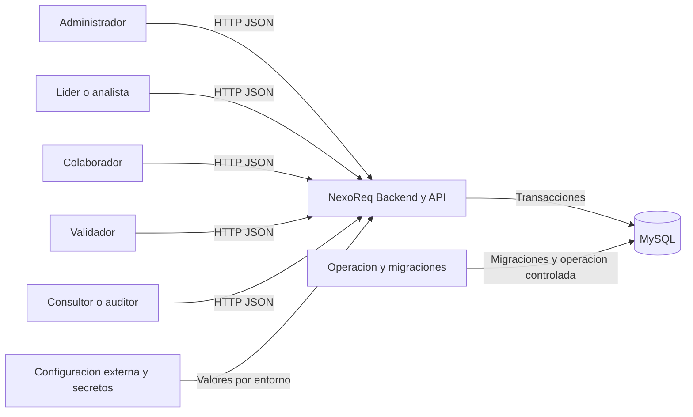
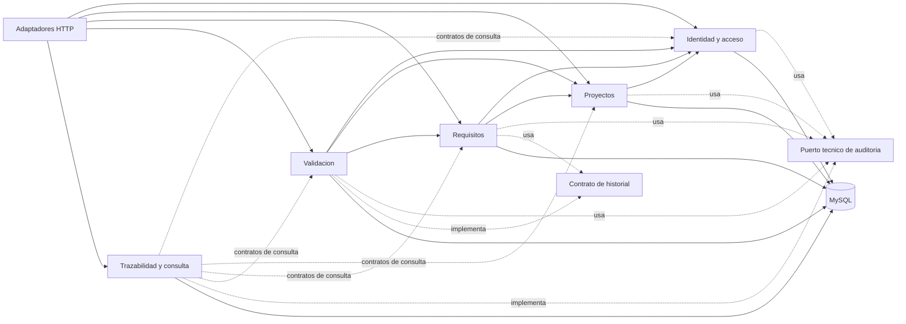
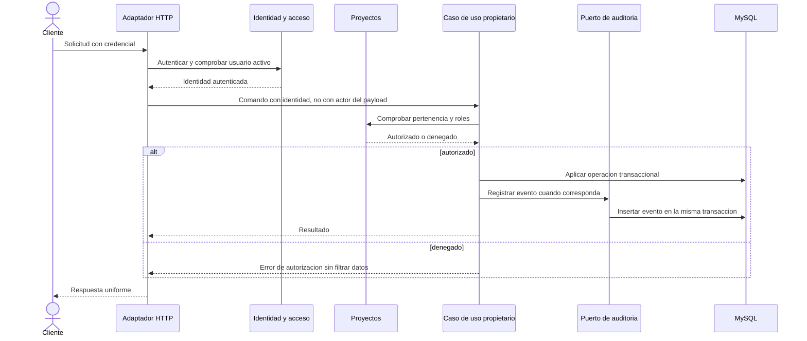
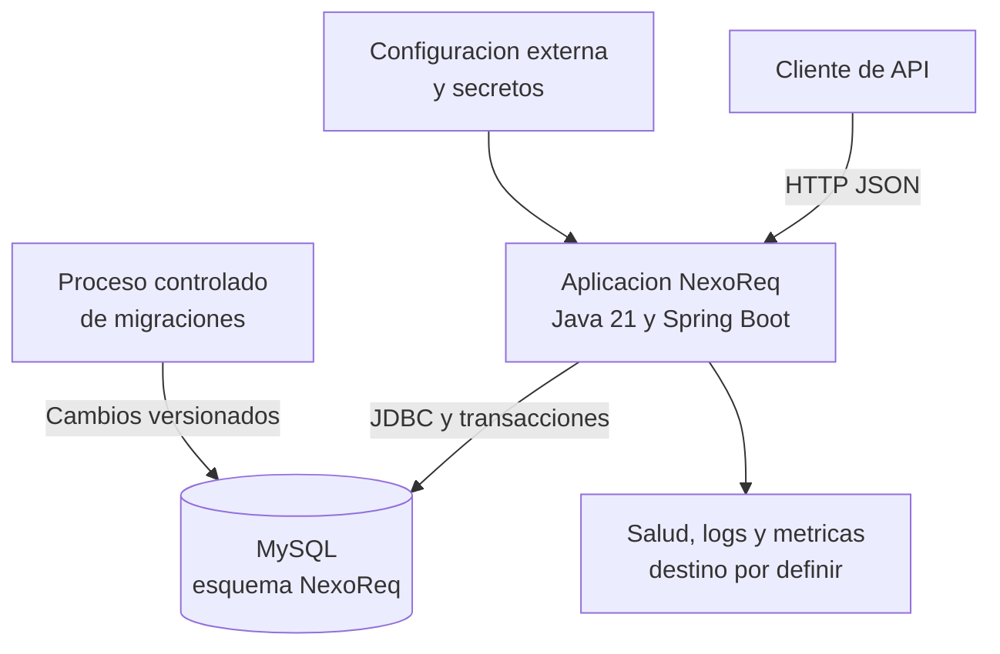

# NexoReq: Arquitectura y Decisiones Técnicas

> - **Identificación:** NEXOREQ-ADT-004
> - **Versión:** 0.1
> - **Estado:** Borrador para revisión
> - **Fecha:** 24 de noviembre de 2026
> - **Fuentes principales:** `docs/01-vision-y-alcance.md`, `docs/02-especificacion-requerimientos.md` y `docs/03-modelo-de-datos.md`, todos en versión 0.1 y estado borrador para revisión
> - **Tecnologías de contexto:** Java 21, Spring Boot, Spring Data JPA y MySQL

## 1. Propósito y alcance

Este documento describe la arquitectura propuesta para el backend y la API del MVP de NexoReq. Define límites del sistema, módulos, responsabilidades, dependencias, flujos críticos y mecanismos transversales, y organiza las decisiones técnicas que deben revisarse antes de implementar.

Los Documentos 01, 02 y 03 siguen siendo borradores. Por tanto, este documento usa sus reglas y requisitos como base de trabajo, pero no los presenta como una línea base formalmente aprobada. Tampoco convierte una recomendación técnica en una decisión aceptada por el solo hecho de documentarla.

### 1.1. Objetivos

- Traducir las capacidades del MVP en una estructura de monolito modular verificable.
- Asignar a cada módulo la propiedad de sus reglas, datos y contratos.
- Definir cómo se aplicarán seguridad, integridad, transacciones, concurrencia y auditoría.
- Establecer criterios comunes para la futura API HTTP/JSON sin sustituir su contrato OpenAPI.
- Proponer alternativas para las decisiones abiertas y hacer visibles sus consecuencias.
- Mantener trazabilidad entre arquitectura, RF-001 a RF-046, RNF-001 a RNF-032 y RN-001 a RN-007.
- Proporcionar condiciones de entrada claras para migraciones, código y pruebas posteriores.

### 1.2. Alcance

La arquitectura cubre:

- identidad, autenticación, autorización y estado de los usuarios;
- proyectos, participantes y roles por proyecto;
- requisitos, criterios de aceptación y versiones;
- validación, decisiones e historial de estados;
- búsqueda, consulta, auditoría y trazabilidad;
- API, errores, paginación, concurrencia y representación temporal;
- configuración, registros técnicos, salud, métricas y despliegue;
- estrategia de calidad y comprobaciones arquitectónicas futuras.

### 1.3. Fuera de alcance

Este documento no contiene:

- código Java, clases, paquetes físicos definitivos o mapeos JPA;
- archivos SQL, migraciones o configuración ejecutable;
- rutas, payloads y esquemas completos de la API;
- infraestructura aprovisionada, pipelines o despliegues realizados;
- pruebas implementadas o evidencia de ejecución;
- interfaz de usuario;
- funcionalidades excluidas del MVP, como IA generativa, integraciones externas, notificaciones externas, adjuntos, firma legal, multitenencia, analítica avanzada o gestión completa de pruebas.

El futuro contrato OpenAPI deberá precisar endpoints, operaciones, esquemas, estados HTTP y ejemplos. Este documento únicamente fija restricciones y criterios que ese contrato deberá respetar.

### 1.4. Estado de las decisiones

Se utilizan estas categorías:

| Categoría | Significado |
| --- | --- |
| **Base documental** | Restricción tomada de los Documentos 01, 02 o 03. Esos documentos continúan en revisión. |
| **Propuesta de arquitectura** | Alternativa recomendada en este documento, pendiente de aprobación. |
| **Pendiente** | Decisión abierta que no puede asumirse durante la implementación. |
| **Aprobada** | Decisión aceptada explícitamente por las personas responsables y registrada como tal. No se asigna este estado a ninguna DP o DMD-P en esta versión. |

Las recomendaciones se identifican con `ADT-P-001` en adelante. Su estado inicial es **Propuesta para aprobación**.

## 2. Impulsores y restricciones arquitectónicas

### 2.1. Impulsores de negocio

La arquitectura debe sostener:

- una fuente única para los requisitos de cada proyecto;
- aislamiento entre proyectos y acceso conforme a permisos explícitos;
- conocimiento inequívoco de la versión vigente;
- aprobación o rechazo atribuible a un validador;
- conservación de versiones, transiciones y decisiones;
- consulta eficiente de estado, prioridad, responsables e historial;
- una base técnica sencilla de desplegar y preparada para evolucionar por módulos.

### 2.2. Atributos de calidad

| Atributo | Consecuencia arquitectónica |
| --- | --- |
| Seguridad | Autenticación previa, autorización en servidor, denegación por defecto y alcance por proyecto. |
| Integridad | Reglas de dominio, claves y restricciones, escrituras transaccionales e inmutabilidad histórica. |
| Auditabilidad | Eventos atribuibles, correlacionables y no modificables desde la API del producto. |
| Mantenibilidad | Módulos con propiedad clara, dependencias explícitas y capas internas. |
| Consistencia | Control optimista, conflictos identificables y límites transaccionales definidos. |
| Rendimiento | Paginación e índices básicos; umbrales y optimizaciones condicionados a DP-007. |
| Operabilidad | Configuración externa, salud, logs estructurados, migraciones reproducibles y procedimientos documentados. |
| Verificabilidad | Trazabilidad a RF, RNF, RN, HU y EA, y pruebas futuras por nivel. |

### 2.3. Restricciones tecnológicas

Son base documental:

- Java 21;
- Spring Boot;
- Spring Data JPA;
- MySQL;
- monolito modular;
- una sola aplicación desplegable para el MVP;
- una instancia MySQL y un esquema controlado por migraciones;
- API HTTP con representaciones JSON en UTF-8;
- configuración dependiente del entorno fuera del artefacto.

Permanecen pendientes la versión concreta de Spring Boot y sus dependencias, la herramienta de compilación, la herramienta de migraciones y la versión exacta de MySQL. La selección debe cerrar DP-010 y DMD-P-006 con evidencia de compatibilidad.

### 2.4. Exclusiones que condicionan el diseño

- No se introduce un bus de eventos, microservicios ni comunicación distribuida en el MVP.
- No se agrega un proveedor externo de identidad sin revisar la exclusión de integraciones y DP-003.
- No se diseñan tablas o endpoints para una interfaz de usuario todavía no especificada.
- Las pruebas son una actividad de ingeniería; no se crea un módulo de gestión de pruebas.
- El archivo no se modela como eliminación ni como estado adicional de validación.

## 3. Contexto y límites del sistema

### 3.1. Actores

| Actor | Interacción principal |
| --- | --- |
| Administrador del sistema | Gestiona usuarios, estado de activación y, según DP-001, roles de alcance global. |
| Líder o analista de proyecto | Gestiona el proyecto, participantes y requisitos conforme a permisos aprobados. |
| Colaborador | Registra o complementa requisitos conforme a su rol en el proyecto. |
| Validador | Revisa y registra aprobación o rechazo de la versión evaluada. |
| Consultor o auditor | Consulta proyectos, requisitos, decisiones y auditoría sin modificar datos. |

Una misma persona puede asumir varios roles en proyectos distintos. La autorización se determina con la identidad activa, la pertenencia vigente, los roles del proyecto y la condición activa o archivada del recurso.

### 3.2. Límites de confianza

1. **Cliente de API.** No es confiable para autorización, estado, pertenencia, roles ni identificadores de actor.
2. **Aplicación NexoReq.** Autentica, autoriza, aplica reglas y coordina transacciones.
3. **MySQL.** Protege integridad referencial, unicidad y persistencia, pero no reemplaza las reglas del dominio.
4. **Configuración y secretos.** Se suministran externamente y solo están disponibles para los componentes que los necesitan.
5. **Operación.** Migraciones, copias, restauración y acceso administrativo requieren controles distintos de la API del producto.

### 3.3. Diagrama de contexto



El diagrama no incorpora sistemas externos porque no forman parte del MVP definido.

## 4. Estilo y principios arquitectónicos

### 4.1. Monolito modular

NexoReq se ejecutará como un proceso y se publicará como un artefacto. Los módulos son límites lógicos y de propiedad dentro de esa unidad, no servicios desplegables independientes.

El enfoque busca:

- transacciones locales para los flujos críticos;
- menor complejidad operativa;
- separación suficiente para evolucionar cada capacidad;
- dependencias observables y comprobables;
- posibilidad futura de extraer módulos solo si existe una necesidad demostrada.

### 4.2. Principios

1. **Propiedad única.** Cada agregado, tabla y repositorio tiene un módulo propietario.
2. **Contratos explícitos.** Los módulos consumen capacidades publicadas, no repositorios ajenos.
3. **Dominio primero.** RN-001 a RN-007 se aplican en casos de uso y dominio, no solo en controladores o restricciones SQL.
4. **Denegación por defecto.** La ausencia de permiso concede cero acceso.
5. **Alcance por proyecto.** Toda lectura y escritura de datos de proyecto verifica autorización.
6. **Historial inmutable.** Versiones históricas, decisiones y transiciones confirmadas no se editan.
7. **Atomicidad auditable.** La acción auditable y su evento se confirman o revierten juntos.
8. **Conflicto visible.** Una actualización concurrente no sobrescribe silenciosamente.
9. **Configuración externa.** Secretos y valores por entorno no se empacan en el artefacto.
10. **Evolución con evidencia.** Desnormalización, caché, búsqueda avanzada o distribución requieren mediciones.

### 4.3. Reglas de dependencia

- El dominio no depende de HTTP, Spring MVC, JPA, MySQL ni detalles operativos.
- La aplicación coordina casos de uso y contratos, sin contener reglas de presentación.
- La infraestructura implementa puertos de persistencia, seguridad y observabilidad.
- Los adaptadores de entrada traducen solicitudes y respuestas, pero no deciden permisos o transiciones.
- No se permiten asociaciones JPA bidireccionales entre agregados de módulos distintos.
- No se comparten entidades persistentes como modelo de integración.
- Un módulo puede referenciar un agregado externo por identificador estable y validarlo mediante un contrato publicado.
- Cualquier componente compartido debe ser técnico, pequeño y sin reglas de negocio de un módulo.

## 5. Vista lógica de módulos

### 5.1. Responsabilidades y propiedad

| Módulo | Responsabilidades | Datos del Documento 03 | Contratos que ofrece |
| --- | --- | --- | --- |
| Identidad y acceso | Usuarios, activación, autenticación, roles globales e identidad del actor. | `app_users`, `roles`, `user_global_roles` | Identidad activa, roles globales y comprobaciones de autenticación. |
| Proyectos | Proyecto, participantes, roles por proyecto, archivo y pertenencia. | `projects`, `project_members`, `project_member_roles` | Comprobar proyecto activo, pertenencia, rol y participantes elegibles. |
| Requisitos | Raíz, código, contenido, criterios, archivo y versiones. | `requirements`, `requirement_versions`, `acceptance_criteria` | Crear, editar, versionar, archivar y consultar requisitos. |
| Validación | Transiciones, decisiones e historial del estado. | `validation_decisions`, `requirement_state_history` | Enviar a revisión, aprobar, rechazar y volver a borrador. |
| Trazabilidad y consulta | Auditoría, búsquedas, filtros, resúmenes y proyecciones de consulta. | `audit_events` y lecturas autorizadas de otros módulos mediante contratos | Registrar eventos, consultar auditoría y componer vistas de lectura. |

Versiones es una subcapacidad del módulo Requisitos. Consulta y auditoría son subcapacidades de Trazabilidad y consulta. Ninguna se despliega por separado.

### 5.2. Dependencias permitidas

| Consumidor | Dependencia permitida | Motivo |
| --- | --- | --- |
| Todos | Identidad y acceso | Obtener identidad activa y contexto autenticado. |
| Proyectos | Identidad y acceso | Validar usuarios y actor de cambios. |
| Requisitos | Proyectos | Validar proyecto, archivo, pertenencia, responsable y validador elegibles. |
| Validación | Requisitos | Leer versión, estado, archivo y aplicar transición sobre el agregado. |
| Validación | Proyectos | Comprobar que el actor tiene rol de validador vigente. |
| Requisitos | Contrato estrecho de historial de Validación | Crear el hecho inicial de estado al crear un requisito o una nueva versión, sin importar la implementación de Validación. |
| Trazabilidad y consulta | Contratos de consulta de todos | Componer lecturas sin modificar agregados ajenos. |
| Módulos que ejecutan acciones auditables | Puerto técnico transversal de auditoría | Registrar un evento dentro de la operación lógica sin depender del módulo de consulta. |

El puerto de auditoría pertenece a la infraestructura transversal y no a un módulo de negocio. Trazabilidad y consulta aporta su implementación persistente y es propietario de `audit_events`, pero los demás módulos dependen del puerto, no del módulo. El contrato solo permite insertar el evento de la operación; no habilita actualización, eliminación ni consulta arbitraria.

Validación orquesta RF-023 a RF-029, pero no escribe directamente tablas propiedad de Requisitos. Requisitos publica un contrato interno para comparar y cambiar el estado de la versión bajo las invariantes del agregado. A la inversa, la creación de un requisito o versión usa un contrato estrecho para registrar el historial inicial; Validación lo implementa sin exponer su repositorio. Los contratos se ubican en el límite de integración y ningún dominio importa la implementación del otro. La coordinación garantiza que estado, decisión, historial y auditoría participen en la misma transacción.

### 5.3. Dependencias prohibidas

- acceso directo a un repositorio de otro módulo;
- escritura directa en tablas de otro módulo;
- navegación JPA desde un agregado hacia entidades persistentes de otro;
- ciclo Requisitos → Validación → Requisitos basado en llamadas recíprocas;
- decisiones de autorización en el módulo de consulta sin delegar a Identidad y Proyectos;
- reconstrucción del estado del requisito desde el JSON de auditoría;
- uso de logs técnicos como sustituto de decisiones o historial de dominio.

### 5.4. Diagrama de módulos



Las flechas representan consumo o implementación de contratos, no acceso libre a implementaciones internas. Los puertos de auditoría e historial son límites de integración, no módulos adicionales. El diseño detallado debe comprobar que Validación y Requisitos no formen un ciclo entre sus dominios o infraestructuras.

### 5.5. Coordinación de operaciones cruzadas

**Propuesta de arquitectura ADT-P-001:** utilizar llamadas síncronas dentro del proceso y una única transacción para los flujos del MVP. El módulo que posee el agregado modificado coordina la operación y consume contratos de lectura o validación de los demás.

No se propone mensajería asíncrona para acciones que deban ser atómicas. Los eventos internos posteriores a la confirmación pueden usarse en el futuro para efectos no críticos, pero no para reemplazar la escritura transaccional de auditoría exigida por RF-043.

## 6. Estructura interna de los módulos

### 6.1. Capas

| Capa | Responsabilidad | Puede depender de |
| --- | --- | --- |
| Entrada | HTTP, validación sintáctica, identidad propagada y transformación de respuestas. | Aplicación y contratos de entrada. |
| Aplicación | Casos de uso, autorización contextual, transacciones y coordinación de puertos. | Dominio y contratos publicados. |
| Dominio | Entidades, valores, políticas, transiciones e invariantes. | Lenguaje y abstracciones propias del dominio. |
| Infraestructura | JPA, MySQL, seguridad, reloj, auditoría, configuración y observabilidad. | Puertos definidos hacia el interior y bibliotecas técnicas. |

### 6.2. Organización

**Propuesta de arquitectura ADT-P-002:** organizar el código futuro por módulo o capacidad, y dentro de cada módulo separar entrada, aplicación, dominio e infraestructura. Esto evita una estructura global por capas donde todos los controladores, servicios y repositorios queden mezclados.

Los nombres de paquetes y clases no se fijan en este documento. La futura estructura deberá permitir comprobar:

- que un módulo no importa infraestructura interna de otro;
- que el dominio no importa marcos;
- que los repositorios se usan únicamente desde su módulo propietario;
- que los contratos públicos son deliberados y pequeños.

### 6.3. Núcleo compartido

El núcleo compartido debe limitarse a conceptos técnicos realmente comunes, por ejemplo:

- identificador de correlación;
- abstracción de reloj;
- representación de errores;
- contexto de identidad autenticada;
- tipos básicos de paginación;
- anotaciones o utilidades técnicas sin semántica de negocio.

No deben colocarse en el núcleo compartido reglas de roles, estados de requisito, permisos o acceso a datos. Si un concepto pertenece a un módulo, se publica mediante un contrato en lugar de trasladarlo a una carpeta común.

## 7. Flujos arquitectónicos principales

Los diagramas siguientes muestran responsabilidades y límites transaccionales. No definen endpoints ni nombres de clases.

### 7.1. Autenticación y autorización de una operación



El mecanismo concreto de credencial y sesión sigue en DP-003. La arquitectura exige que el actor provenga del contexto autenticado y que la autorización se repita en cada operación protegida.

### 7.2. Creación de proyecto y rol inicial

La operación deberá:

1. verificar que el actor activo tiene permiso para crear proyectos;
2. crear el proyecto;
3. crear la participación inicial que resulte de DP-001;
4. asignar el rol inicial aprobado;
5. registrar auditoría;
6. confirmar o revertir todas las escrituras juntas.

Quién recibe el rol inicial, qué rol es y quién puede modificarlo permanecen pendientes. El flujo no debe implementarse hasta resolver DP-001.

### 7.3. Creación y envío de requisito

```mermaid
sequenceDiagram
    actor Actor as Actor autorizado
    participant Req as Requisitos
    participant Proj as Proyectos
    participant Val as Validacion
    participant History as Contrato de historial
    participant Audit as Auditoria
    participant DB as MySQL

    Actor->>Req: Crear requisito
    Req->>Proj: Validar proyecto activo y permiso
    Req->>DB: Crear raiz, codigo, version 1 y criterios
    Req->>History: Registrar estado inicial DRAFT
    History->>DB: Insertar historial inicial
    Req->>Audit: Registrar alta
    Audit->>DB: Insertar evento
    DB-->>Req: Escrituras listas
    Req-->>Actor: Confirmacion atomica

    Actor->>Val: Solicitar envio a revision
    Val->>Req: Leer version vigente y archivo
    Val->>Proj: Validar actor, responsable y validador
    Val->>Val: Verificar completitud RN-003
    Val->>Req: Solicitar cambio de estado DRAFT a IN_REVIEW
    Req->>DB: Actualizar estado bajo invariantes del agregado
    Val->>DB: Insertar historial de transicion
    Val->>Audit: Registrar transicion
    Audit->>DB: Insertar evento
    DB-->>Val: Escrituras listas
    Val-->>Actor: Confirmacion atomica
```

La generación del código depende de DP-002. Ningún código suministrado por el cliente debe aceptarse como autoridad sin aplicar la estrategia aprobada.

### 7.4. Aprobación o rechazo

La operación de decisión debe mantener, en una transacción:

- comprobación de usuario activo, participación y rol autorizado;
- versión exacta en `IN_REVIEW` y recursos no archivados;
- decisión inmutable con participante, instante y observación;
- estado actualizado;
- transición de historial vinculada a la decisión;
- evento de auditoría.

Un rechazo sin observación se rechaza antes de escribir. La política que compare creador o último editor con el validador depende de DP-005.

### 7.5. Nueva versión de un requisito aprobado

```mermaid
sequenceDiagram
    actor Actor as Actor autorizado
    participant Req as Requisitos
    participant Proj as Proyectos
    participant History as Contrato de historial
    participant Audit as Auditoria
    participant DB as MySQL

    Actor->>Req: Solicitar cambio sobre aprobado
    Req->>Proj: Validar permiso y proyecto activo
    Req->>DB: Bloquear brevemente la raiz o verificar lock_version
    Req->>DB: Obtener version vigente aprobada
    Req->>DB: Reservar siguiente version_number
    Req->>DB: Crear nueva version DRAFT
    Req->>DB: Copiar criterios como filas nuevas
    Req->>History: Registrar estado inicial DRAFT
    History->>DB: Insertar historial inicial
    Req->>Audit: Registrar version creada
    Audit->>DB: Insertar evento
    DB-->>Req: Escrituras listas o conflicto
    Req-->>Actor: Confirmacion o conflicto identificable
```

La versión aprobada anterior no cambia. Derivar la vigente por el mayor número es la propuesta DMD-P-002, todavía pendiente de aprobación.

### 7.6. Archivo

Archivar un requisito o proyecto:

- escribe actor e instante de archivo en la raíz;
- no cambia el estado de validación;
- no elimina ni reescribe hijos;
- registra auditoría en la misma transacción;
- bloquea operaciones de modificación y transición posteriores;
- conserva consultas autorizadas en solo lectura.

La API del MVP no ofrece la operación inversa mientras DP-011 siga diferida.

## 8. Arquitectura de seguridad

### 8.1. Activos y amenazas principales

| Activo o amenaza | Control arquitectónico requerido |
| --- | --- |
| Credenciales y secretos | Configuración externa, protección criptográfica vigente y exclusión de logs y auditoría. |
| Acceso horizontal entre proyectos | Autorización por proyecto en cada caso de uso y consultas siempre acotadas. |
| Autoescalamiento | Gobierno de asignación, prohibiciones explícitas y auditoría según DP-001. |
| Suplantación de actor | Actor tomado exclusivamente del contexto autenticado. |
| Modificación de historial | Operaciones append-only, repositorios sin métodos de actualización y privilegios mínimos cuando sea viable. |
| Sobrescritura concurrente | `lock_version` y error de conflicto. |
| Enumeración de recursos ajenos | Respuestas que no revelen existencia o datos fuera del alcance autorizado. |
| Exposición por logs o errores | Sanitización, mensajes controlados e identificador de correlación. |

### 8.2. Autenticación: DP-003

| Alternativa | Ventajas | Costes o riesgos |
| --- | --- | --- |
| Credenciales locales y token opaco revocable | Revocación y desactivación inmediatas; no requiere integración externa. | Exige almacenar credenciales protegidas, sesiones y expiración; aumenta responsabilidad de seguridad. |
| Credenciales locales y JWT | Validación eficiente y menor estado de acceso. | Revocación, rotación y desactivación inmediata son más complejas. |
| Proveedor OIDC externo | Reduce manejo local de credenciales. | Introduce una integración y puede contradecir la exclusión de SSO corporativo del MVP. Requeriría revisión de alcance. |

**Recomendación ADT-P-003, pendiente:** para el MVP, evaluar primero credenciales locales con Spring Security y token opaco revocable de duración limitada. La recuperación podría ser administrativa si se decide evitar correo externo. No se fijan todavía algoritmo, duración, bloqueo por intentos, mecanismo de recuperación ni creación de la primera cuenta.

La alternativa solo puede aprobarse después de definir:

- clientes previstos;
- revocación y cierre de sesión;
- desactivación inmediata;
- recuperación de acceso;
- protección contra fuerza bruta;
- rotación de secretos;
- procedimiento seguro para la cuenta administrativa inicial.

### 8.3. Autorización por proyecto: DP-001

| Alternativa | Evaluación |
| --- | --- |
| RBAC fijo y mínimo | Simple, auditable y alineado con los actores del MVP. Requiere aprobar catálogo y matriz de concesión. |
| Roles configurables y permisos persistidos | Flexible, pero amplía administración, autoescalamiento y pruebas. |
| Permisos directos por usuario | Granular, pero difícil de comprender, auditar y mantener. |

**Recomendación ADT-P-004, pendiente:** adoptar para el MVP un RBAC pequeño y estable, basado en los actores ya descritos. Los códigos y permisos concretos no se consideran aprobados en esta versión.

La decisión debe responder expresamente:

- quién recibe qué rol al crear el proyecto;
- quién puede agregar o retirar participantes;
- quién puede conceder o retirar cada rol;
- si el administrador global puede intervenir y bajo qué evidencia;
- cómo se impide la autoasignación de permisos superiores;
- cómo se evita dejar un proyecto sin una persona capaz de administrarlo;
- qué ocurre con asignaciones cuando un usuario es desactivado o retirado.

Controles propuestos para revisión:

- denegar cualquier autocambio que incremente privilegios;
- comprobar la autoridad del otorgante y el ámbito del rol;
- auditar asignación y revocación en la misma transacción;
- no confiar en un rol aportado por el cliente;
- separar roles globales de roles de proyecto;
- evaluar una regla para proteger al último líder activo.

### 8.4. Autoaprobación: DP-005

| Alternativa | Consecuencia |
| --- | --- |
| Prohibir que creador o último editor apruebe | Mayor separación de funciones; puede bloquear equipos de una sola persona. |
| Permitir si también tiene rol de validador | Flujo simple para equipos pequeños; menor independencia. |
| Configurar por proyecto | Flexible, pero añade configuración, gobierno y casos de prueba no especificados. |

**Recomendación ADT-P-005, pendiente:** preferir separación entre creador o último editor y quien aprueba. Debe decidirse si la misma restricción aplica al rechazo y si los equipos previstos pueden operar con dos personas. No se introduce una excepción implícita para administradores.

### 8.5. Secretos y datos sensibles

- No se almacenan contraseñas, tokens, claves o secretos en el repositorio ni en configuración versionada.
- Las credenciales locales, si se aprueban, nunca se guardan en texto claro.
- Los logs, errores y `event_data` de auditoría usan listas permitidas, no copias completas de solicitudes.
- Los valores sensibles se inyectan mediante el mecanismo operativo que se defina en DP-009.
- El acceso administrativo a MySQL no se reutiliza como identidad de ejecución de la aplicación.

### 8.6. Aplicación de autorización

La autorización debe ocurrir en la capa de aplicación, antes de modificar el agregado, y repetirse dentro de la transacción cuando dependa de estado mutable. Los adaptadores HTTP pueden aplicar controles generales, pero no sustituyen la comprobación de proyecto, rol, archivo y estado.

Las consultas por identificador deben incluir el proyecto autorizado o comprobarlo antes de retornar datos. Una consulta global sin filtro de alcance se considera una violación arquitectónica.

## 9. Persistencia y consistencia

### 9.1. Relación con el Documento 03

El Documento 03 contiene el modelo lógico y diccionario. Este documento no los duplica. Adopta como propuestas:

- propiedad de tablas por módulo;
- FKs con `RESTRICT` o `NO ACTION`;
- ausencia de `CASCADE DELETE`;
- raíz estable de requisito y contenido versionado;
- historial y decisiones append-only;
- auditoría separada del estado de dominio;
- control optimista en agregados mutables.

### 9.2. Unidad de trabajo

**Propuesta ADT-P-006:** cada caso de uso que modifique datos delimita una transacción en la capa de aplicación. Los repositorios participan en esa unidad y no confirman de manera independiente.

| Operación | Escrituras que se confirman o revierten juntas |
| --- | --- |
| Crear requisito | Raíz, código, primera versión, criterios iniciales, historial y auditoría. |
| Enviar a revisión | Completitud, estado, historial y auditoría. |
| Aprobar o rechazar | Autorización, decisión, estado, historial y auditoría. |
| Volver a borrador | Estado, historial y auditoría, conservando la decisión anterior. |
| Crear versión | Número, versión, criterios copiados, historial y auditoría. |
| Archivar | Marca, actor, instante y auditoría. |
| Cambiar membresía o rol | Asociación o revocación y auditoría. |
| Cambiar estado de usuario | Activación o desactivación y auditoría. |

### 9.3. Concurrencia

- `lock_version` detecta cambios concurrentes en agregados mutables.
- Un conflicto se comunica de manera identificable; no se reintenta copiando encima del cambio confirmado.
- La numeración de versiones puede requerir bloqueo breve de la raíz del requisito.
- La generación del código depende de DP-002 y debe ser atómica con el alta.
- Las restricciones únicas son la última defensa, no el único control.
- El orden de bloqueo proyecto → requisito → versión es una propuesta que debe validarse con los casos de uso.

### 9.4. Decisiones DMD-P

| ID | Propuesta recomendada, aún no aprobada | Dependencia |
| --- | --- | --- |
| DMD-P-001 | Una fila por período de membresía o rol ofrece mejor historia; debe compararse con reutilizar la fila y depender de auditoría. | DP-001 y compatibilidad MySQL. |
| DMD-P-002 | Derivar la versión vigente con `MAX(version_number)` e índice; materializar solo con evidencia. | DP-007. |
| DMD-P-003 | `DATETIME(6)` en UTC y API con zona inequívoca. | Contrato API y pruebas temporales. |
| DMD-P-004 | Referencia de auditoría `entity_type` + `entity_id`, con datos filtrables normalizados y JSON limitado. | Contrato de auditoría. |
| DMD-P-005 | Mantener historial de estado separado de auditoría. | Flujo de validación. |
| DMD-P-006 | Fijar una versión de MySQL compatible y comprobar la propuesta de InnoDB, `utf8mb4`, JSON, `CHECK`, índices y comportamiento transaccional. | DP-009 y DP-010. |

### 9.5. Migraciones

Las migraciones futuras deberán ser versionadas, reproducibles y aplicarse de forma controlada. La herramienta permanece en DP-010.

Controles mínimos propuestos:

- cada cambio de esquema tiene identificador y orden;
- no se modifica retrospectivamente una migración ya aplicada en un entorno compartido;
- la compatibilidad con la versión exacta de MySQL se prueba;
- la aplicación no inicia contra un esquema incompatible sin producir un diagnóstico claro;
- el procedimiento de respaldo y recuperación se integra con DP-009.

## 10. Arquitectura de la API

### 10.1. Principios

- HTTP y JSON UTF-8 de forma consistente;
- recursos y operaciones alineados con los cinco módulos;
- identidad derivada de la autenticación;
- permisos evaluados en servidor;
- listas paginadas con límite configurable;
- búsqueda y filtros siempre acotados a proyectos autorizados;
- fechas con zona inequívoca;
- errores uniformes;
- OpenAPI sincronizado con la implementación futura.

### 10.2. Límites de este documento

No se fijan rutas, nombres de campos de transporte, esquemas completos ni códigos para cada operación. El futuro contrato OpenAPI deberá cubrir autenticación, permisos, filtros, paginación, respuestas, errores y ejemplos.

### 10.3. Paginación, búsqueda y filtros

**Propuesta ADT-P-007:**

- usar paginación obligatoria con límite máximo configurable;
- ofrecer orden estable con un criterio de desempate;
- no devolver colecciones ilimitadas;
- documentar filtros combinables y su semántica;
- aplicar el alcance autorizado antes del filtro y la agregación;
- medir búsqueda por código, título y descripción antes de adoptar `FULLTEXT`.

No se decide todavía entre paginación por página o cursor. El contrato debe seleccionar una modalidad según estabilidad de orden, volumen y experiencia del cliente.

### 10.4. Concurrencia en el contrato

El cliente debe poder enviar una precondición basada en la versión de bloqueo conocida. Las alternativas son:

- campo explícito de versión en el comando;
- encabezado de precondición con una etiqueta de entidad;
- control interno cuando el caso de uso no admite edición del cliente.

La elección se cierra en el contrato API. En cualquier alternativa, un valor obsoleto produce un conflicto identificable y no una actualización silenciosa.

### 10.5. Fechas y compatibilidad

Si se aprueba DMD-P-003, la base opera en UTC y la API usa una representación ISO-8601 con `Z` u offset. Nunca se expone una fecha y hora local sin zona.

La política de versionado del contrato se registra como **ADT-P-008, propuesta para aprobación**. Debe definirse antes de publicar una API estable y contemplar cambios incompatibles, retirada de campos y sincronización de OpenAPI.

## 11. Errores y respuestas

### 11.1. Categorías

| Categoría | Ejemplo | Resultado esperado |
| --- | --- | --- |
| Validación de entrada | Campo ausente o inválido | Código estable y detalles por campo. |
| Autenticación | Credencial ausente, inválida o usuario inactivo | Denegación sin crear identidad. |
| Autorización | Proyecto o acción no permitidos | Denegación sin exponer datos ajenos. |
| Recurso inexistente | Identificador no encontrado en alcance | Respuesta uniforme sin filtrar existencia externa. |
| Conflicto | `lock_version` obsoleto o unicidad concurrente | Error identificable y sin sobrescritura. |
| Estado inválido | Transición no permitida o recurso archivado | Regla incumplida y estado vigente conservado. |
| Error interno | Fallo no esperado | Identificador de correlación, sin traza ni secretos para el cliente. |

### 11.2. Estructura propuesta

**Propuesta ADT-P-009:** toda respuesta de error incluye:

- código estable legible por máquina;
- mensaje comprensible;
- identificador de correlación;
- detalles por campo cuando corresponda;
- contexto mínimo no sensible.

El mapeo exacto a estados HTTP pertenece al contrato API. La implementación futura debe mantener separado el diagnóstico interno del mensaje público.

## 12. Auditoría, trazabilidad y registros técnicos

### 12.1. Responsabilidades distintas

| Mecanismo | Propósito | Fuente de verdad |
| --- | --- | --- |
| Decisiones e historial de dominio | Reconstruir validación, actor, estado y evidencia. | Tablas normalizadas del dominio. |
| Auditoría | Responder quién hizo qué, cuándo, sobre qué y con qué resultado. | `audit_events` append-only. |
| Logs técnicos | Diagnosticar solicitudes, latencia, fallos y dependencias. | Plataforma de registros, no dominio. |
| Métricas | Observar volumen, errores, latencia y capacidad. | Sistema operativo que se defina en DP-009. |

### 12.2. Escritura de auditoría

Los módulos invocan un puerto técnico y síncrono de auditoría dentro de su transacción. Trazabilidad y consulta implementa ese puerto para insertar el evento, pero los módulos de negocio no dependen de Trazabilidad. La implementación tampoco permite que el llamador actualice, elimine o consulte arbitrariamente registros existentes. El contrato transversal de escritura evita un ciclo; las consultas autorizadas permanecen en Trazabilidad y consulta mediante sus propios contratos de lectura.

Los eventos mínimos corresponden a RF-041. Cada evento conserva actor, instante, acción, entidad, proyecto cuando corresponda y resultado. El `correlation_id` enlaza auditoría y logs, pero no sustituye las claves del dominio.

### 12.3. Inmutabilidad y privilegios

- La API del producto no expone actualización ni eliminación de auditoría.
- El repositorio de escritura solo ofrece inserción.
- La consulta aplica permisos de proyecto y filtros autorizados.
- Como defensa operativa, se recomienda evaluar una identidad DB sin `UPDATE` o `DELETE` sobre `audit_events`.
- Migraciones y operaciones administrativas usan un canal controlado distinto.

La viabilidad de privilegios separados depende de DP-009 y no se declara aprobada.

### 12.4. Retención y datos sensibles

DP-008 mantiene abiertos plazo, particionamiento, archivo y purga. No se elimina evidencia por una política implícita.

Auditoría y logs no incluyen:

- contraseñas, tokens, claves o secretos;
- cuerpos completos sin filtrado;
- trazas internas en respuestas;
- datos personales innecesarios;
- contenido duplicado cuando basta con identificadores y campos cambiados permitidos.

## 13. Configuración y observabilidad

### 13.1. Configuración externa

La configuración dependiente del entorno se suministra fuera del artefacto. Debe distinguir:

- valores públicos de comportamiento;
- conexión y credenciales de base de datos;
- material criptográfico;
- parámetros de autenticación;
- límites de paginación;
- niveles de logging;
- configuración de migraciones;
- parámetros operativos que resulten de DP-007 a DP-009.

La aplicación debe validar al inicio los valores obligatorios y fallar con un diagnóstico seguro si falta una configuración esencial. Ningún valor secreto se muestra en salud, errores o logs.

### 13.2. Logging estructurado

**Propuesta ADT-P-010:**

- emitir registros estructurados con instante, nivel, categoría, `correlation_id` y resultado;
- propagar correlación durante todo el caso de uso;
- registrar fallos con contexto técnico suficiente, sin datos sensibles;
- evitar usar identificadores personales como única clave de correlación;
- separar nivel y destino por entorno sin recompilar.

No se elige todavía una plataforma de agregación de logs.

### 13.3. Salud

El mecanismo de salud requerido por RNF-030 debe:

- indicar si el proceso puede atender solicitudes;
- comprobar dependencias esenciales de forma segura;
- no exponer credenciales, cadenas de conexión, versiones internas innecesarias ni datos de negocio;
- distinguir, si el entorno lo necesita, inicio, disponibilidad y vitalidad sin imponer una plataforma concreta.

### 13.4. Métricas

DP-007 sigue abierta. Antes de fijar métricas de aceptación deben aprobarse volumen, concurrencia, mezcla de operaciones, entorno de carga, percentiles y umbrales.

Como categorías para evaluación, no como objetivos cuantificados, se proponen:

- latencia y tasa de errores por operación;
- cantidad y duración de transacciones;
- conflictos optimistas y deadlocks;
- uso y espera del pool de conexiones;
- volumen de consultas paginadas;
- crecimiento de versiones, historial y auditoría;
- fallos de autenticación y denegaciones sin registrar secretos.

### 13.5. Alertas y diagnóstico

Las alertas, tableros y destinos de métricas dependen del entorno de DP-009. El MVP no presupone nube, contenedores, Kubernetes ni un producto de observabilidad determinado.

## 14. Vista de despliegue

### 14.1. Unidad desplegable

La base documental exige un artefacto de aplicación y una instancia MySQL. No se presupone la forma de empaquetado operativo ni el proveedor de infraestructura.



La protección del canal debe definirse con el entorno de DP-009. El diagrama no asume terminación TLS, proxy, red ni certificados.

### 14.2. Secuencia de preparación e inicio

El procedimiento operativo futuro debe documentar:

1. validación de configuración y secretos;
2. conectividad segura con MySQL;
3. copia o punto de recuperación cuando corresponda;
4. aplicación controlada de migraciones;
5. inicio del artefacto;
6. verificación de salud;
7. comprobación funcional mínima;
8. procedimiento de reversión o recuperación ante fallo.

Este orden es una propuesta y debe ajustarse al entorno de DP-009 y a la herramienta de DP-010.

### 14.3. Copias y restauración

DP-009 debe definir:

- responsables de copia y restauración;
- frecuencia y almacenamiento;
- cifrado y control de acceso;
- verificación periódica de restauración;
- coherencia entre esquema y datos;
- tratamiento de auditoría;
- objetivos de recuperación, sin inventar RPO o RTO en este documento.

### 14.4. Disponibilidad y escalado

El monolito modular no implica una sola instancia de proceso para siempre, pero esta versión no diseña escalado horizontal. Antes de considerarlo deben resolverse:

- objetivos cuantificados de DP-007;
- topología y sesiones de DP-009;
- coordinación de migraciones;
- generación concurrente de códigos y versiones;
- consistencia de tokens o sesiones de DP-003;
- capacidad y topología de MySQL.

No se introduce caché distribuida ni réplica de lectura sin evidencia y una revisión de consistencia.

## 15. Estrategia de calidad y pruebas

Las pruebas descritas son trabajo futuro. Los CP del Documento 02 siguen siendo previstos, no implementados.

### 15.1. Niveles

| Nivel | Objetivo | Ejemplos de cobertura |
| --- | --- | --- |
| Unidad de dominio | Verificar invariantes y transiciones sin infraestructura. | RN-001 a RN-007, completitud, archivo, rechazo y versionamiento. |
| Aplicación | Verificar autorización, coordinación y límites transaccionales con dobles controlados. | Casos de uso críticos y errores. |
| Integración | Verificar JPA, MySQL, restricciones, migraciones y rollback. | Unicidad, FKs, `lock_version`, auditoría atómica. |
| Seguridad | Verificar autenticación, denegación por defecto y aislamiento. | EA-001 a EA-004 y acceso cruzado entre proyectos. |
| API | Verificar contrato, validación, errores, paginación y fechas. | RNF-018 a RNF-021. |
| Aceptación | Convertir EA-001 a EA-014 en escenarios reproducibles. | Flujos completos del MVP. |
| Rendimiento | Medir el perfil que se apruebe. | DP-007, sin umbrales inventados. |
| Arquitectura | Impedir dependencias y accesos prohibidos. | Módulos, capas y propiedad de repositorios. |

### 15.2. Casos críticos

La estrategia debe incluir:

- usuario inactivo o sin pertenencia;
- intento de acceso a un proyecto ajeno;
- asignación de responsable o validador de otro proyecto;
- transición inválida;
- rechazo sin observación;
- operación sobre requisito o proyecto archivado;
- edición de una versión aprobada o histórica;
- creación concurrente de versión;
- conflicto de `lock_version`;
- fallo de auditoría que provoca rollback;
- preservación de autoría tras desactivar o retirar;
- consultas paginadas y filtradas sin fuga de información.

### 15.3. Base de datos de pruebas

Las pruebas de integración deben ejercitar la versión de MySQL aprobada, no sustituirla únicamente por una base con semántica diferente. La herramienta para proporcionar el entorno reproducible se decidirá con DP-009 y DP-010.

### 15.4. Comprobaciones arquitectónicas

**Propuesta ADT-P-011:** automatizar en el futuro reglas que detecten:

- ciclos entre módulos;
- importación del repositorio o infraestructura de otro módulo;
- dependencia del dominio respecto de Spring, HTTP o JPA;
- controladores que acceden directamente a repositorios;
- uso de entidades persistentes como contrato entre módulos;
- exposición de operaciones de modificación de auditoría.

No se fija una biblioteca concreta hasta cerrar DP-010.

## 16. Registro de decisiones

### 16.1. Decisiones heredadas del Documento 02

Todas permanecen abiertas. La columna “recomendación” no cambia su estado.

| ID | Clasificación | Alternativas principales | Recomendación para revisión | Condición de cierre |
| --- | --- | --- | --- | --- |
| DP-001 | Bloquea diseño | RBAC fijo; roles configurables; permisos directos. | RBAC fijo y mínimo, con rol inicial, matriz de concesión, anti-autoescalamiento, protección del último líder y auditoría. | Producto y arquitectura aprueban catálogo, rol inicial, otorgantes y controles. |
| DP-002 | Bloquea implementación | Secuencia por proyecto; UUID/ULID; prefijo de proyecto más secuencia. | Secuencia por proyecto con prefijo fijo no derivado del nombre. Formato, longitud, collation y capacidad siguen abiertos. | Se aprueban formato, generación atómica y validación del contrato. |
| DP-003 | Bloquea diseño | Token opaco local; JWT local; proveedor externo. | Evaluar primero token opaco revocable con credencial local; proveedor externo requiere revisar alcance. | Se aprueban credencial, sesión, revocación, expiración, recuperación y cuenta inicial. |
| DP-004 | Bloquea diseño | Catálogos cerrados; tablas configurables; texto libre. | Catálogos cerrados validados en dominio para el MVP; no agregar campos obligatorios sin decisión de negocio. | Se aprueban campos y valores de tipo y prioridad. |
| DP-005 | Bloquea diseño | Separación estricta; permitir con rol; configurar por proyecto. | Preferir que creador o último editor no apruebe; validar viabilidad con tamaño de equipo. | Se aprueba política para aprobación y rechazo, incluidas excepciones. |
| DP-006 | Puede resolverse posteriormente | UI web, otra interfaz o solo API. | Mantener fuera del MVP y revisar alcance si se incorpora. | Existe un entregable de interfaz revisado. |
| DP-007 | Bloquea aceptación/operación | Diferentes perfiles y objetivos de carga. | Definir volumen, concurrencia, percentiles, disponibilidad y evidencia antes de optimizar. | Métricas y umbrales cuantificados están aprobados. |
| DP-008 | Bloquea aceptación/operación | Conservación completa; partición/archivo; purga regulada. | Estimar crecimiento y aprobar retención sin comprometer RF-046. | Se aprueban plazo, responsables, archivo, purga y restauración. |
| DP-009 | Bloquea aceptación/operación | Entornos y topologías por definir. | Documentar infraestructura, red, TLS, secretos, usuarios DB, copias, restauración y observabilidad. | El entorno y procedimiento operativo son verificables. |
| DP-010 | Bloquea implementación | Maven o Gradle; Flyway o Liquibase; líneas compatibles de Spring Boot. | Evaluar Maven Wrapper y Flyway por simplicidad; fijar versiones solo tras verificar soporte de Java 21, JPA y MySQL. | Versiones, dependencias, build y migraciones están aprobados y fijados. |
| DP-011 | Puede resolverse posteriormente | Archivo irreversible en MVP o desarchivo autorizado. | Mantener sin operación inversa; cualquier ampliación vuelve a alcance. | Se especifican permisos, efectos, auditoría y criterios de aceptación. |

### 16.2. Decisiones heredadas del Documento 03

| ID | Estado | Recomendación para revisión | Condición de cierre |
| --- | --- | --- | --- |
| DMD-P-001 | Pendiente | Preferir una fila por período si se necesita historia consultable de membresías y roles. | Se coordina con DP-001 y se define unicidad de períodos activos. |
| DMD-P-002 | Pendiente | Derivar vigente con `MAX(version_number)`; materializar solo con evidencia. | Se aprueba tras revisar concurrencia y DP-007. |
| DMD-P-003 | Pendiente | `DATETIME(6)` UTC y API con zona inequívoca. | Se prueban conexión, conversión, serialización y orden. |
| DMD-P-004 | Pendiente | Referencia polimórfica de auditoría con sobre normalizado y JSON limitado. | Se aprueba contrato de eventos y campos permitidos. |
| DMD-P-005 | Pendiente | Historial de estado separado de auditoría. | Se aprueba como fuente de verdad de transiciones. |
| DMD-P-006 | Pendiente | Elegir una línea soportada de MySQL y fijar versión exacta después de verificar InnoDB, `utf8mb4`, JSON, `CHECK`, índices y transacciones. | Servidor, driver y migraciones superan pruebas de compatibilidad. |

### 16.3. Propuestas nuevas del Documento 04

| ID | Propuesta | Estado | Consecuencia principal |
| --- | --- | --- | --- |
| ADT-P-001 | Comunicación síncrona en proceso y transacción local para flujos críticos. | Propuesta para aprobación | Mantiene atomicidad sin bus de mensajes. |
| ADT-P-002 | Organización por módulo con capas internas. | Propuesta para aprobación | Hace comprobables propiedad y dependencias. |
| ADT-P-003 | Priorizar autenticación local con token opaco revocable para evaluación. | Propuesta para aprobación | Evita integración externa, pero exige responsabilidad de seguridad. |
| ADT-P-004 | RBAC fijo y mínimo para el MVP. | Propuesta para aprobación | Reduce complejidad; requiere catálogo y gobierno explícitos. |
| ADT-P-005 | Separar aprobador de creador o último editor. | Propuesta para aprobación | Mejora independencia; puede afectar equipos pequeños. |
| ADT-P-006 | Transacción delimitada por caso de uso en capa de aplicación. | Propuesta para aprobación | Coordina dominio, persistencia y auditoría. |
| ADT-P-007 | Paginación obligatoria y búsqueda medida antes de `FULLTEXT`. | Propuesta para aprobación | Evita colecciones ilimitadas y optimización prematura. |
| ADT-P-008 | Definir política de evolución de API antes de publicar contrato estable. | Propuesta para aprobación | Evita cambios incompatibles sin gobierno. |
| ADT-P-009 | Estructura uniforme de errores con correlación. | Propuesta para aprobación | Facilita clientes y diagnóstico seguro. |
| ADT-P-010 | Logging estructurado y correlacionado. | Propuesta para aprobación | Mejora diagnóstico sin convertir logs en auditoría. |
| ADT-P-011 | Comprobaciones automatizadas de límites modulares. | Propuesta para aprobación | Previene erosión del monolito modular. |

Ninguna ADT-P se considera aceptada hasta que se registre una aprobación explícita. Después de aprobarse, las decisiones relevantes pueden separarse en ADR individuales con contexto, consecuencias y fecha.

## 17. Matriz de trazabilidad arquitectónica

La matriz expresa responsabilidad de diseño, no implementación ni prueba ejecutada.

### 17.1. Módulos frente a requisitos funcionales

| Módulo propietario | RF principales | Colaboraciones |
| --- | --- | --- |
| Identidad y acceso | RF-001 a RF-006 | Proyectos aporta pertenencia y roles de proyecto para RF-005 y RF-006. |
| Proyectos | RF-007 a RF-012 | Identidad valida actores; auditoría registra cambios. |
| Requisitos | RF-013 a RF-022; RF-030 a RF-034 | Proyectos valida alcance; Validación conserva decisiones y estados; auditoría registra eventos. |
| Validación | RF-023 a RF-029 | Requisitos aporta versión y archivo; Proyectos aporta autorización del validador. |
| Trazabilidad y consulta | RF-035 a RF-046 | Consume contratos de lectura de todos los módulos y aplica alcance autorizado. |

### 17.2. Mecanismos frente a requisitos no funcionales

| Mecanismo | RNF respaldados | Alcance |
| --- | --- | --- |
| Autenticación, autorización y secretos | RNF-001 a RNF-005 | Diseño condicionado por DP-001, DP-003 y DP-005. |
| FKs, reglas, transacciones y concurrencia | RNF-006 a RNF-009 | Integridad en dominio, aplicación y persistencia. |
| Paginación, índices y medición | RNF-010 a RNF-012 | Métricas y aceptación siguen en DP-007. |
| Módulos, capas, migraciones y logging | RNF-013 a RNF-017 | Versiones y herramientas siguen en DP-010. |
| Principios de API, errores y tiempo | RNF-018 a RNF-021 | El detalle se cerrará en OpenAPI. |
| Estrategia de pruebas | RNF-022 a RNF-024 | Actividades futuras, no evidencia existente. |
| Matrices y evidencia identificable | RNF-025 a RNF-027 | Deben mantenerse al cambiar alcance. |
| Artefacto, configuración, salud y operación | RNF-028 a RNF-032 | Entorno y objetivos siguen en DP-007 y DP-009. |

### 17.3. Mecanismos frente a reglas de negocio

| Regla | Mecanismos arquitectónicos |
| --- | --- |
| RN-001 | Módulo Proyectos, alcance obligatorio, FK a proyecto, autorización y solo lectura por archivo. |
| RN-002 | Raíz de requisito, generador transaccional, unicidad y código inmutable. |
| RN-003 | Validación de dominio diferenciada para guardar borrador y enviar a revisión. |
| RN-004 | Máquina de estados, archivo ortogonal, historial y rechazo de transiciones inválidas. |
| RN-005 | Rol autorizado, decisión inmutable, actor, instante, observación y auditoría. |
| RN-006 | Nueva versión en borrador, criterios copiados e historial aprobado preservado. |
| RN-007 | Archivo lógico, ausencia de borrado físico, FKs restrictivas y consultas históricas. |

### 17.4. Decisiones que bloquean artefactos posteriores

| Artefacto posterior | Decisiones que debe recibir |
| --- | --- |
| Modelo de autorización y criterios de seguridad | DP-001, DP-003, DP-005, ADT-P-003 a ADT-P-005. |
| Migraciones y mapeos JPA | DP-002, DP-004, DP-010, DMD-P-001 a DMD-P-006. |
| Contrato OpenAPI | DP-001 a DP-005, DMD-P-003, ADT-P-007 a ADT-P-009. |
| Pruebas de aceptación | DP-001, DP-003 a DP-005 y decisiones de API. |
| Preparación operativa | DP-007 a DP-009, DMD-P-006 y ADT-P-010. |

## 18. Riesgos, supuestos y deuda

| Riesgo | Consecuencia | Mitigación o decisión |
| --- | --- | --- |
| Política de roles ambigua | Escalamiento o bloqueo de administración. | Resolver DP-001 antes del diseño detallado. |
| Autenticación incompleta | Acceso inseguro o recuperación imposible. | Resolver DP-003 con revisión de seguridad. |
| Consulta sin proyecto autorizado | Fuga horizontal de información. | Contratos acotados, denegación por defecto y pruebas negativas. |
| Ciclo entre módulos | Acoplamiento y transacciones difíciles de gobernar. | Propietario único del caso de uso y comprobaciones ADT-P-011. |
| Puerto de auditoría mal diseñado | Ciclo de dependencias o pérdida de atomicidad. | Contrato síncrono estrecho de inserción; consultas separadas. |
| Evento de auditoría sin contrato | JSON inconsistente o datos sensibles. | Cerrar DMD-P-004 y lista permitida. |
| Código o versión concurrentes | Colisión o doble vigencia percibida. | Estrategia atómica, bloqueo breve, unicidad y conflicto visible. |
| Herramientas o versiones incompatibles | Migraciones o mapeos incorrectos. | Resolver DP-010 y DMD-P-006 con pruebas reales. |
| Historial y auditoría crecientes | Coste y consultas degradadas. | DP-007 y DP-008, índices medidos y política operativa. |
| Uso incorrecto de zona horaria | Orden y atribución ambiguos. | DMD-P-003 y pruebas de conversión. |
| Error público demasiado detallado | Exposición de estructura o secretos. | ADT-P-009 y sanitización central. |
| Sesiones no revocables | Usuario desactivado conserva acceso. | DP-003 debe garantizar invalidación efectiva. |
| Optimización prematura | Complejidad sin evidencia. | Medir antes de caché, `FULLTEXT`, desnormalización o distribución. |
| Cambios de API sin gobierno | Clientes rotos y OpenAPI desactualizado. | Resolver ADT-P-008 antes de estabilidad pública. |
| Acceso administrativo directo a DB | Alteración de evidencia fuera de API. | Privilegios mínimos, procedimientos, migraciones y copias controladas. |

Supuestos revisables:

- el MVP opera para una sola organización lógica y no es multitenant;
- los flujos críticos caben en transacciones locales;
- no existen integraciones externas obligatorias;
- un único esquema MySQL satisface el MVP;
- el volumen inicial no justifica distribución ni desnormalización sin medición.

Si un supuesto cambia, deben revisarse alcance, matrices y decisiones afectadas antes de implementar la ampliación.

## 19. Criterios para aprobar el Documento 04

Este borrador estará preparado para convertirse en línea base cuando:

- los módulos, propietarios y dependencias estén aceptados y no formen ciclos;
- los límites transaccionales de los flujos críticos sean verificables;
- se confirme que RN-001 a RN-007 tienen un mecanismo arquitectónico explícito;
- DP-001, DP-003, DP-004 y DP-005 se resuelvan antes de cerrar diseño de seguridad y dominio;
- DP-002 y DP-010 se resuelvan antes de crear esquema o base técnica;
- DMD-P-001 a DMD-P-006 y ADT-P-001 a ADT-P-011 se aprueben, ajusten o rechacen explícitamente;
- las decisiones de DP-007 a DP-009 tengan responsables y momento de resolución antes de aceptación operativa;
- DP-006 y DP-011 permanezcan registradas si se difieren;
- el futuro contrato OpenAPI pueda derivarse sin inventar permisos, estados o errores;
- ninguna afirmación de implementación o prueba se confunda con una propuesta;
- las personas responsables de producto, seguridad y arquitectura registren su revisión.

Hasta entonces, este documento sirve como propuesta coordinada y no autoriza por sí solo la generación de código, migraciones o despliegues.
